🇨🇳 中文 | 🇺🇸 [English](README_EN.md) | 🇷🇺 
[Русский](README_RU.md) | 🇮🇷 [فارسی](README_FA.md)

# NIVA Network机场官方地址(2026年11月18日更新)
NIVA Network机场官网地址</br>
✅含菲律宾家宽（订阅低价AI）</br>

最新地址01：[app.niva.lol](https://to.iix.im/niva03)</br>
最新地址02：[app.niva.lol](https://to.iix.im/niva01)</br>
官方地址：[mizuku.net](https://to.iix.im/niva02)</br>

2026最新好用的机场推荐与节点分享：[https://github.com/jdnei/JiChangTuiJian](https://github.com/jdnei/JiChangTuiJian)</br>
## Telegram VPN 机场福利社  #AD
[机场抽奖群](https://331024.de/archives/choujiang)｜[机场聊天群](https://331024.de/archives/choujiang)｜[机场体验群](https://331024.de/archives/choujiang)</br>

[https://331024.de/archives/choujiang](https://331024.de/archives/choujiang)

## 邀请码
`此邀请码注册，送2天7G试用套餐（此活动官方随时取消）`
```bash
Bfmlanad
```
----

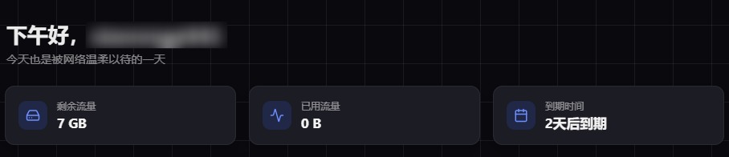 

----
## 优惠码/折扣码
`8.0折，截止日期：11.13`
```bash
NIVA2000
```
## 简介
NIVA Network机场，采用 VLESS + REALITY /Xhttp，Shadowsocks ，隐私至上，无日志保留,售后快速相应，免费技术支持。
## 优势
• 多地区全球稳定节点：🇭🇰 香港 / 🇹🇼 台湾 / 🇯🇵 日本 / 🇸🇬 新加坡 / 🇺🇸 美国 / 🇬🇧 英国 / 🇵🇭 菲律宾，</br>
• 带有部分家宽🏠节点，[美国家宽](https://github.com/jdnei/niva#1us)、[澳门家宽](https://github.com/jdnei/niva#2mo)、[香港家宽](https://github.com/jdnei/niva#3hk)、[台湾家宽](https://github.com/jdnei/niva#4tw)、[澳大利亚家宽](https://github.com/jdnei/niva#5au)、[菲律宾家宽](https://github.com/jdnei/niva#6ph)、</br>
• 三网优化，提升连接稳定性</br>
• 套餐`澜`一次性等提供额外`专线节点`，适合长期稳定生产力使用</br>
## 套餐

| 系列   | 套餐              | 流量         | 价格         | 付款周期       | 速率      | 同时在线设备     | 线路 / 节点                                  | 特色 / 备注                              |
| ---- | --------------- | ---------- | ---------- | ---------- | ------- | ---------- | ---------------------------------------- | ------------------------------------ |
| MIO  | MIO-Entry-R1    | 50GB       | ¥35 / 月    | 月付         | 不限速     | 多设备（未注明数量） | 电信 CN2 / 联通9929 / 移动CMI2优化；全球 ISP / 家宽节点 | 独立节点组，不含Niva节点；大部分为真实本地家宽IP；不提供SLA保障 |
| MIO  | MIO-Standard-R1 | 100GB      | ¥49 / 月    | 月付         | 不限速     | 多设备（未注明数量） | 电信 CN2 / 联通9929 / 移动CMI2优化；全球 ISP / 家宽节点 | 独立节点组，不含Niva节点；大部分为真实本地家宽IP；不提供SLA保障 |
| MIO  | MIO-Reserve-R1  | 300GB      | ¥105 / 月   | 月付         | 不限速     | 多设备（未注明数量） | 电信 CN2 / 联通9929 / 移动CMI2优化；全球 ISP / 家宽节点 | 独立节点组，不含Niva节点；大部分为真实本地家宽IP；不提供SLA保障 |
| Niva | 💧 涟 · 轻量自用     | 100GB      | ¥8.80 / 月  | 月付         | 150Mbps | 5台         | 联通 / 移动优化；全球住宅 / ISP运营商出口                | 多地区覆盖；支持AI日常使用及多出口选择                 |
| Niva | 🌊 涌 · 日常主力     | 300GB      | ¥15.80 / 月 | 月付         | 300Mbps | 7台         | 联通 / 移动优化；全球住宅 / ISP运营商出口                | 适合日常使用、多设备及流媒体需求                     |
| Niva | 🌀 澜 · 重度多人     | 550GB      | ¥25.80 / 月 | 月付         | 1Gbps   | 8台         | 联通 / 移动优化；全球住宅 / ISP运营商出口                | 适合重度用户、多人共享及大流量需求                    |
| ONE  | 🫧 沧 · 入门流量     | 150GB（总量）  | ¥29.80     | 一次性 / 永久有效 | 不限速     | 多设备（未注明数量） | Niva节点；联通 / 移动优化；按倍率扣量                   | 无自动续费；流量用完为止；可重复购买，余量叠加              |
| ONE  | 🕳 渊 · 大流量      | 500GB（总量）  | ¥68.80     | 一次性 / 永久有效 | 不限速     | 多设备（未注明数量） | Niva节点；联通 / 移动优化；按倍率扣量                   | 无自动续费；流量用完为止；可重复购买，余量叠加              |
| ONE  | 🌌 湛 · 家庭多设备    | 4.88TB（总量） | ¥499       | 一次性 / 永久有效 | 不限速     | 无限设备       | Niva节点；联通 / 移动优化；按倍率扣量                   | 适合家庭及多设备用户；无自动续费；余量可叠加               |

### 套餐说明

- **MIO 系列：** 主打电信CN2高级优化，同时兼顾联通、移动，采用CN2、9929、CMI2精品直连线路，提供多国家及地区ISP出口，大部分为真实家宽IP。独立节点组，不包含Niva节点，不提供SLA保障。
- **Niva 系列：** 主打联通、移动优化，提供全球住宅及ISP运营商出口，支持日常AI使用、多地区节点和多出口选择，按月付费。
- **ONE 系列：** 基于Niva节点的一次性流量套餐，永久有效，不自动续费，流量用完为止。支持重复购买及剩余流量叠加，按节点倍率扣除流量。
- **套餐换购：** 已有Niva套餐的用户可直接换购MIO，剩余价值自动抵扣。
- **运营商建议：** 商家建议电信用户优先选择MIO，联通及移动用户可选择Niva或ONE。
- **注意事项：** MIO的ISP住宅线路不保证稳定性，不提供SLA保障；实际速度和节点可用性以网络环境为准。


## 📊 性能实测与分析  
#### 1.1电信晚高峰测速表现  
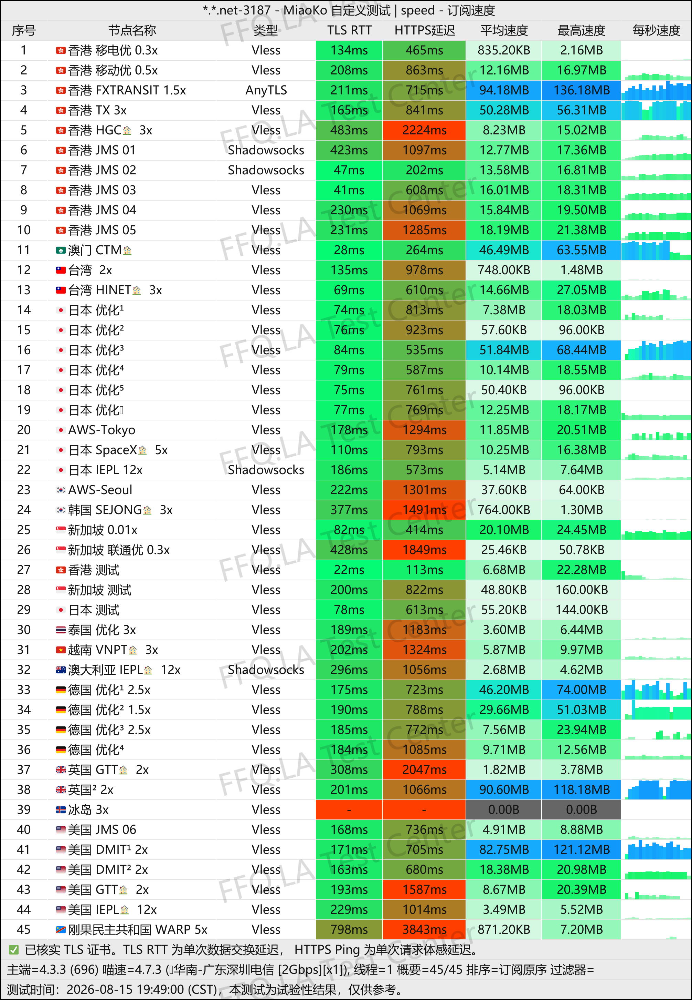  
#### 1.2联通晚高峰测速表现  
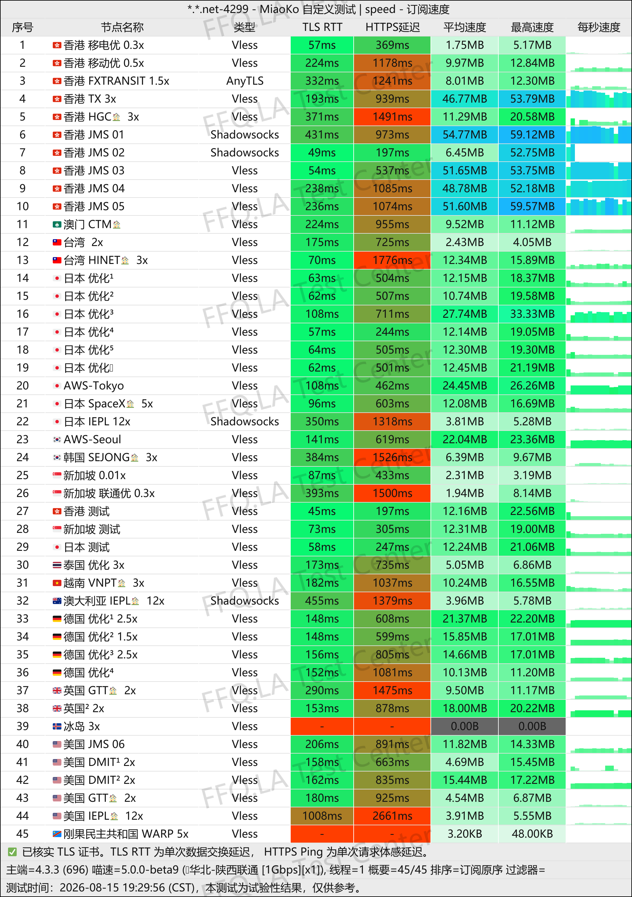  
#### 1.3移动晚高峰测速表现  
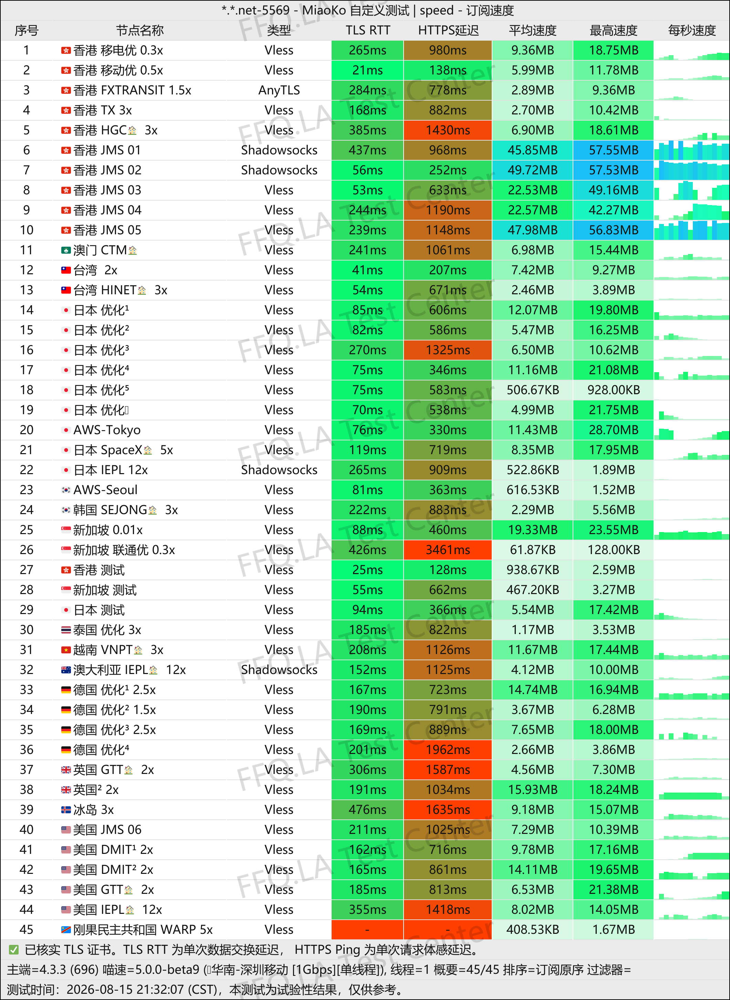  
#### 2.1流媒体解锁报告  
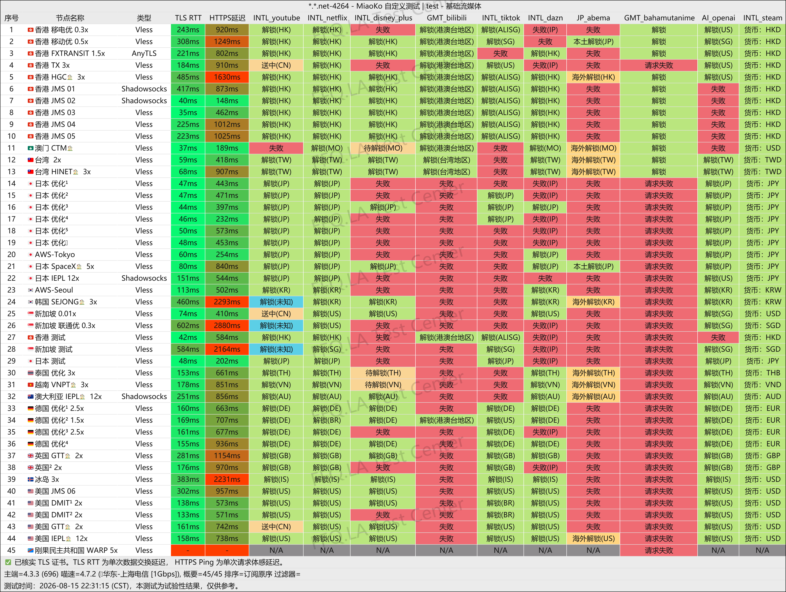    
#### 2.2AI解锁报告  
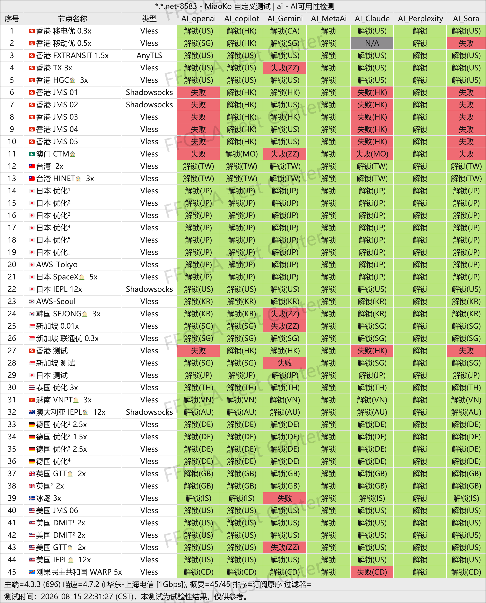  
#### 3.落地入口分析  
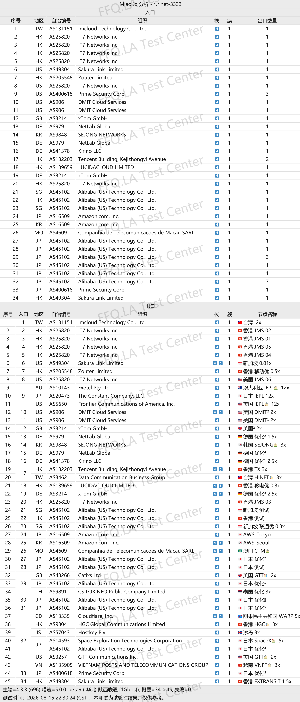
#### 4.家宽纯净度分析 
##### 1.us
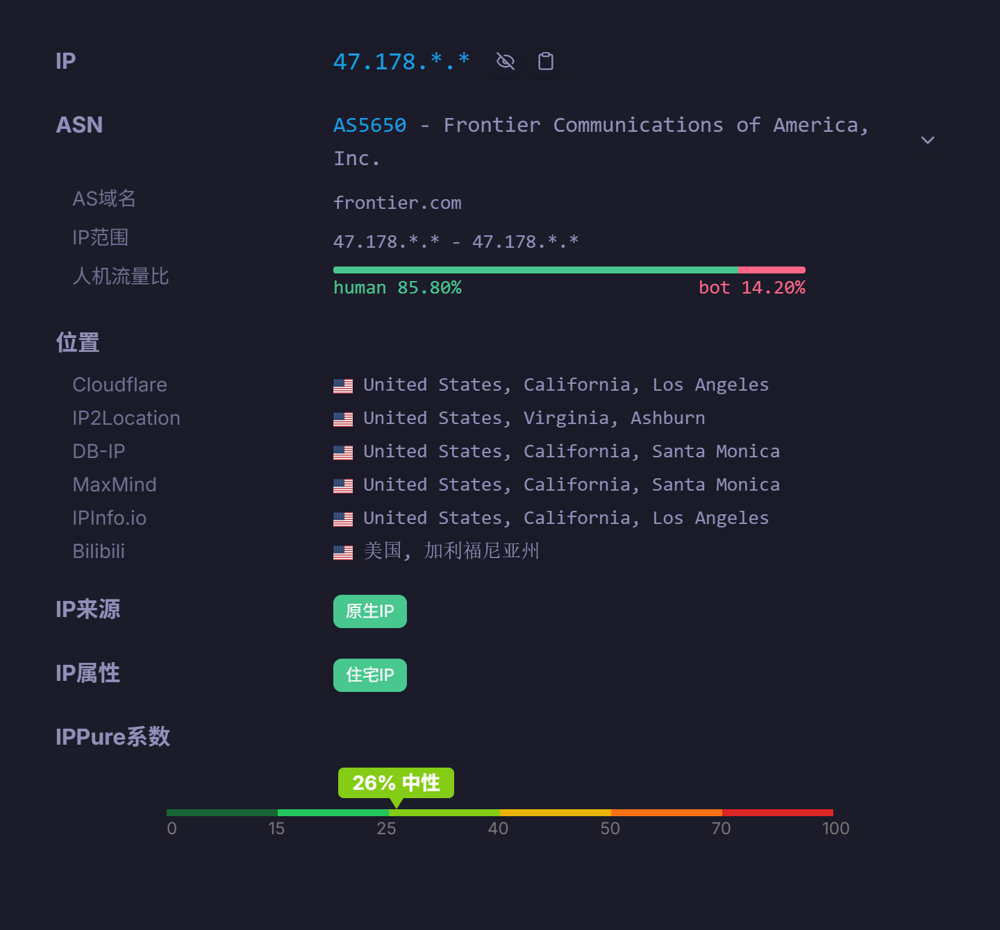
##### 2.mo
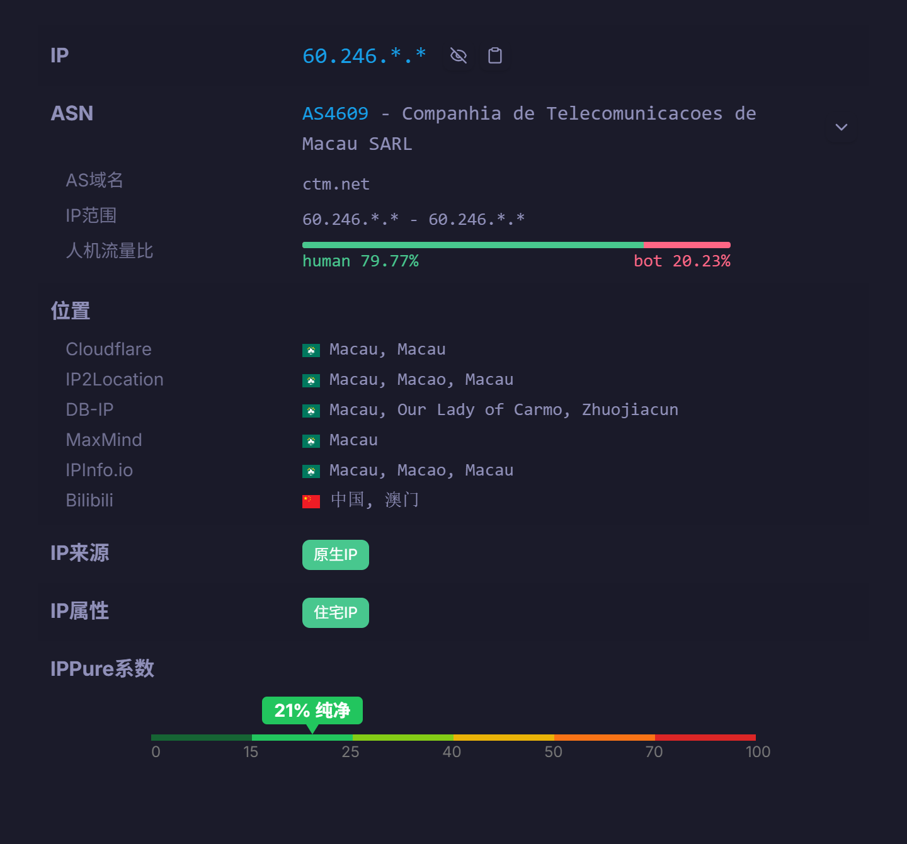
##### 3.hk
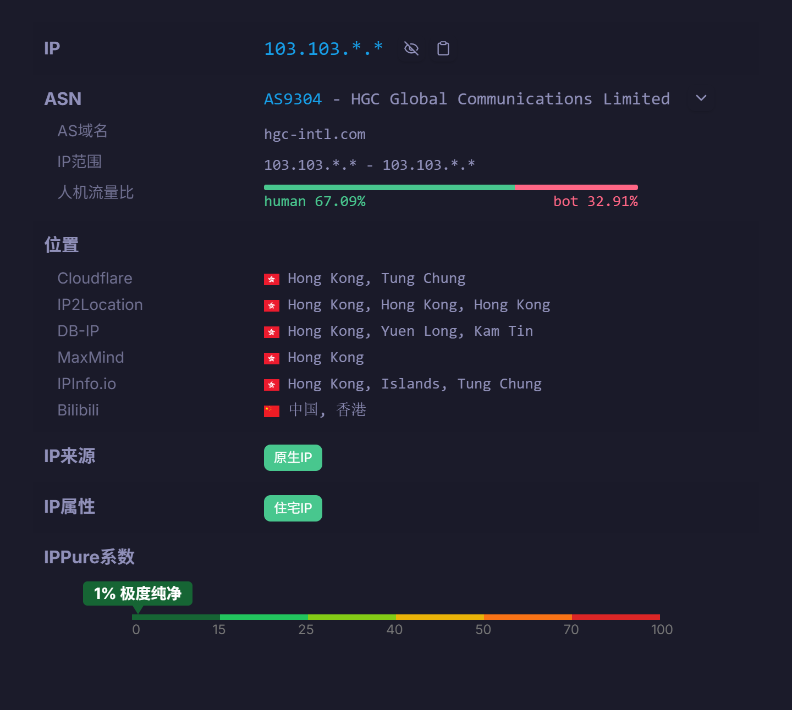
##### 4.tw
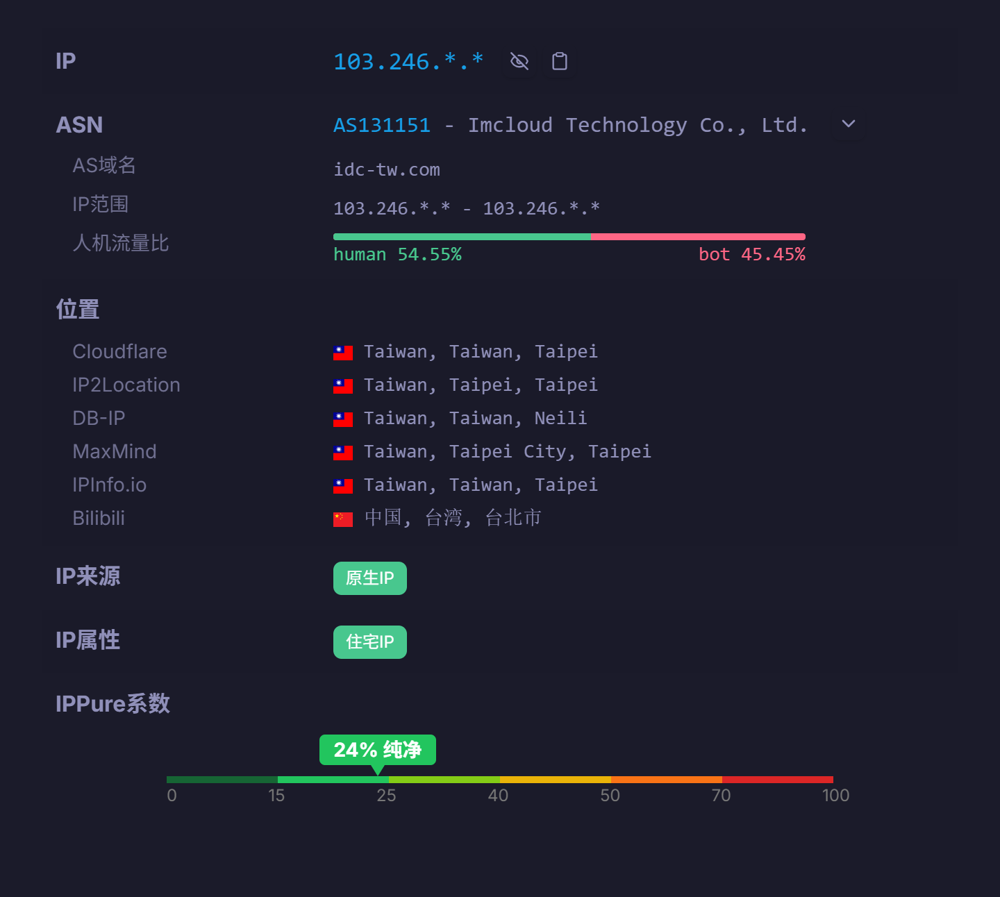
##### 5.au
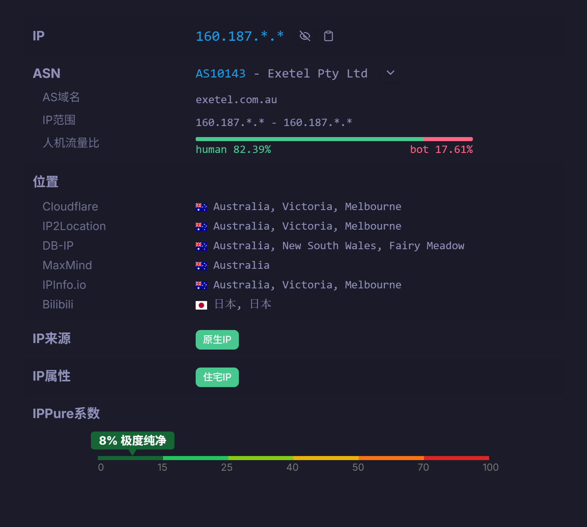
##### 6.ph
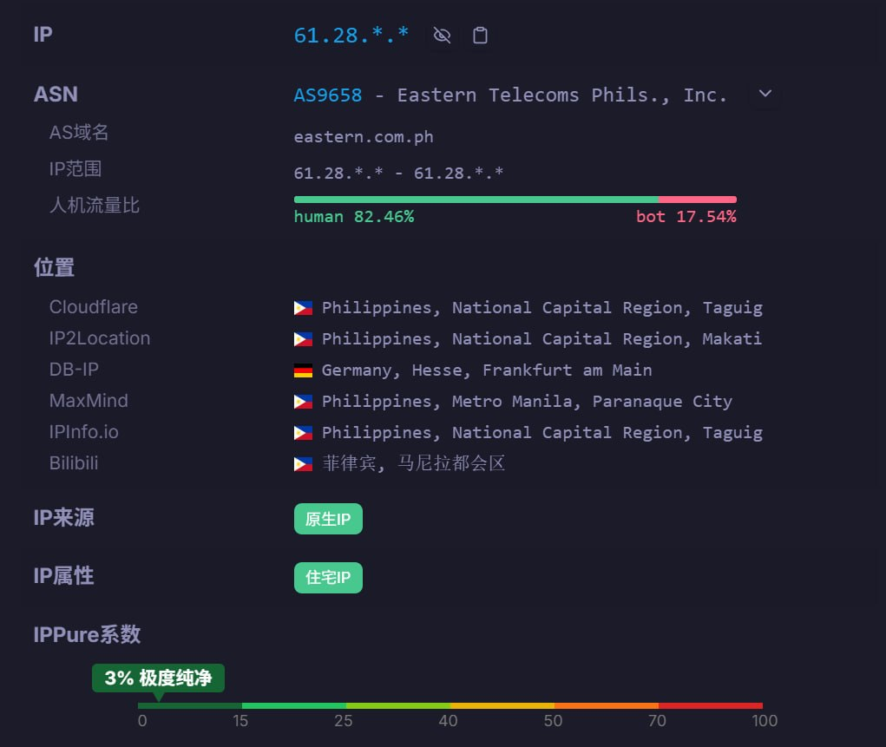
