🇨🇳 [中文](README.md) | 🇺🇸 English | 🇷🇺 [Русский](README_RU.md) | 🇮🇷 [فارسی](README_FA.md)

# NIVA Network VPN Official Website (Updated November 18, 2026)

NIVA Network VPN Official Website<br>
✅ Includes Philippine residential IP nodes (for lower-cost AI subscriptions)<br>

Latest Address 01: [app.niva.lol](https://to.iix.im/niva03)<br>
Latest Address 02: [app.niva.lol](https://to.iix.im/niva01)<br>
Official Website: [mizuku.net](https://to.iix.im/niva02)<br>

2026 Best VPN Recommendations and Proxy Node Sharing: [https://github.com/jdnei/JiChangTuiJian](https://github.com/jdnei/JiChangTuiJian)<br>

## Telegram VPN Community #AD

[VPN Giveaway Group](https://331024.de/archives/choujiang) | [VPN Chat Group](https://331024.de/archives/choujiang) | [VPN Trial Group](https://331024.de/archives/choujiang)<br>

[https://331024.de/archives/choujiang](https://331024.de/archives/choujiang)

## Invitation Code

`Register with this invitation code to receive a free 2-day trial plan with 7 GB of traffic (the provider may discontinue this promotion at any time).`

```bash
Bfmlanad
```

---

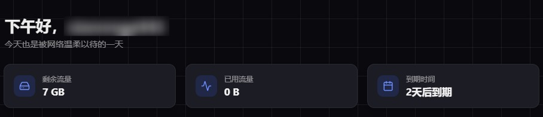

---

## Coupon Code / Discount Code

`20% OFF. Expires November 13.`

```bash
NIVA2000
```

## Introduction

NIVA Network VPN is a multi-protocol network service provider supporting VLESS + REALITY / XHTTP and Shadowsocks.

The service emphasizes privacy protection, a no-logs policy, responsive customer support, and free technical assistance.

## Advantages

- **Global Node Coverage:** Offers nodes in multiple countries and regions, including 🇭🇰 Hong Kong, 🇹🇼 Taiwan, 🇯🇵 Japan, 🇸🇬 Singapore, 🇺🇸 the United States, 🇬🇧 the United Kingdom, and 🇵🇭 the Philippines.<br>

- **Residential IP Nodes:** Provides selected home broadband and residential IP connections, including [US Residential IPs](https://github.com/jdnei/niva#1us), [Macau Residential IPs](https://github.com/jdnei/niva#2mo), [Hong Kong Residential IPs](https://github.com/jdnei/niva#3hk), [Taiwan Residential IPs](https://github.com/jdnei/niva#4tw), [Australian Residential IPs](https://github.com/jdnei/niva#5au), and [Philippine Residential IPs](https://github.com/jdnei/niva#6ph).<br>

- **Optimized Connections for Three Major Chinese ISPs:** Network routing is optimized to improve connection stability.<br>

- **Dedicated Network Nodes:** Selected packages, including the one-time Lan (澜) package, provide additional `dedicated-line nodes` for users requiring stable connections for long-term productivity.<br>

## Subscription Plans

| Series | Plan | Traffic | Price | Billing Cycle | Speed | Simultaneous Devices | Network Routes / Nodes | Features / Notes |
|---|---|---|---|---|---|---|---|---|
| MIO | MIO-Entry-R1 | 50 GB | ¥35/month | Monthly | Unlimited | Multiple devices (number not specified) | Optimized China Telecom CN2 / China Unicom 9929 / China Mobile CMI2; global ISP and residential IP nodes | Independent node group without Niva nodes; most IPs are genuine local home broadband addresses; no SLA guarantee |
| MIO | MIO-Standard-R1 | 100 GB | ¥49/month | Monthly | Unlimited | Multiple devices (number not specified) | Optimized China Telecom CN2 / China Unicom 9929 / China Mobile CMI2; global ISP and residential IP nodes | Independent node group without Niva nodes; most IPs are genuine local home broadband addresses; no SLA guarantee |
| MIO | MIO-Reserve-R1 | 300 GB | ¥105/month | Monthly | Unlimited | Multiple devices (number not specified) | Optimized China Telecom CN2 / China Unicom 9929 / China Mobile CMI2; global ISP and residential IP nodes | Independent node group without Niva nodes; most IPs are genuine local home broadband addresses; no SLA guarantee |
| Niva | 💧 Ripple · Light Personal Use | 100 GB | ¥8.80/month | Monthly | 150 Mbps | 5 | Optimized China Unicom / China Mobile routes; global residential and ISP exit nodes | Multi-region coverage; supports everyday AI usage and multiple exit locations |
| Niva | 🌊 Surge · Everyday Primary Plan | 300 GB | ¥15.80/month | Monthly | 300 Mbps | 7 | Optimized China Unicom / China Mobile routes; global residential and ISP exit nodes | Suitable for daily use, multiple devices, and streaming |
| Niva | 🌀 Lan · Heavy Multi-User Plan | 550 GB | ¥25.80/month | Monthly | 1 Gbps | 8 | Optimized China Unicom / China Mobile routes; global residential and ISP exit nodes | Suitable for heavy users, shared usage, and high traffic requirements |
| ONE | 🫧 Cang · Entry-Level Traffic | 150 GB (total) | ¥29.80 | One-time / Permanent validity | Unlimited | Multiple devices (number not specified) | Niva nodes; optimized China Unicom / China Mobile routes; multiplier-based traffic deductions | No automatic renewal; valid until traffic is exhausted; repeat purchases allowed, with unused balances combined |
| ONE | 🕳 Yuan · High Traffic | 500 GB (total) | ¥68.80 | One-time / Permanent validity | Unlimited | Multiple devices (number not specified) | Niva nodes; optimized China Unicom / China Mobile routes; multiplier-based traffic deductions | No automatic renewal; valid until traffic is exhausted; repeat purchases allowed, with unused balances combined |
| ONE | 🌌 Zhan · Family and Multiple Devices | 4.88 TB (total) | ¥499 | One-time / Permanent validity | Unlimited | Unlimited devices | Niva nodes; optimized China Unicom / China Mobile routes; multiplier-based traffic deductions | Suitable for families and multi-device users; no automatic renewal; unused balances can be combined |

### Subscription Plan Notes

- **MIO Series:** Focuses on premium China Telecom CN2 optimization while also optimizing connections for China Unicom and China Mobile. It uses high-quality direct routes, including CN2, 9929, and CMI2, and provides ISP exit nodes in multiple countries and regions. Most IPs are genuine residential broadband addresses. MIO has an independent node group that does not include Niva nodes, and no SLA guarantee is provided.

- **Niva Series:** Focuses on optimized connections for China Unicom and China Mobile, providing global residential and ISP exit nodes. It supports everyday AI usage, multiple regions, and a choice of exit locations, with monthly billing.

- **ONE Series:** One-time traffic packages based on Niva nodes. They remain valid indefinitely, do not automatically renew, and can be used until the purchased traffic is exhausted. Users can purchase additional packages and combine remaining traffic balances. Traffic is deducted according to each node's multiplier.

- **Plan Switching:** Existing Niva subscribers can switch directly to MIO, with the remaining value of their current subscription automatically deducted from the new purchase price.

- **ISP Recommendations:** The provider recommends MIO for China Telecom users, while China Unicom and China Mobile users may choose Niva or ONE.

- **Important Notes:** MIO's ISP residential connections do not have guaranteed stability or SLA coverage. Actual speeds and node availability depend on network conditions.

## 📊 Performance Tests and Analysis

#### 1.1 China Telecom Evening Peak-Hour Speed Test

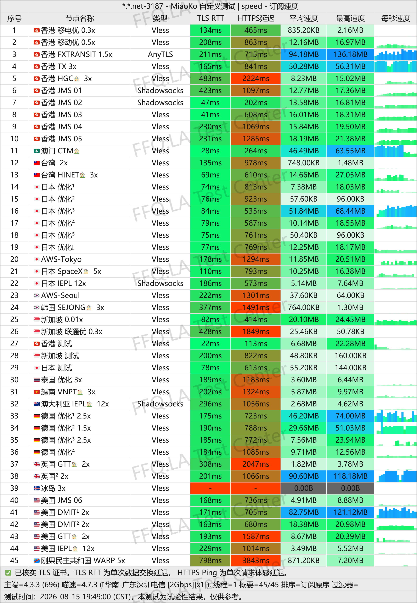

#### 1.2 China Unicom Evening Peak-Hour Speed Test

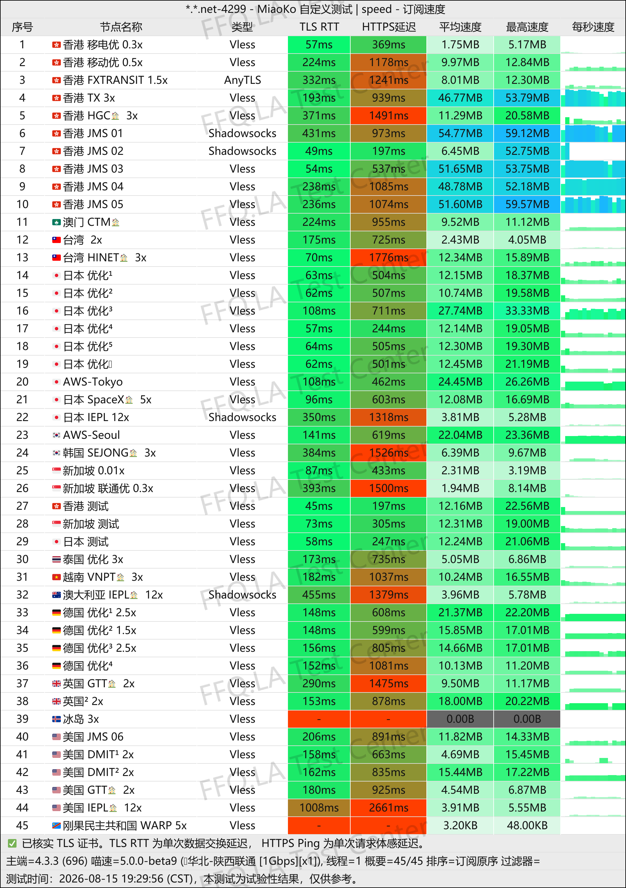

#### 1.3 China Mobile Evening Peak-Hour Speed Test

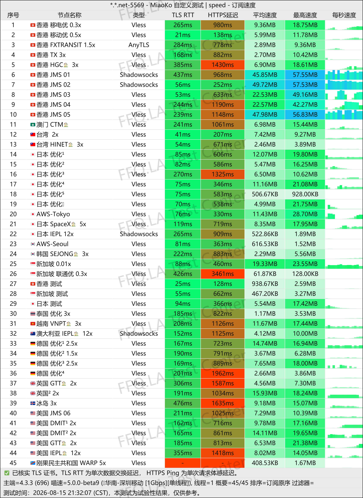

#### 2.1 Streaming Platform Unblocking Report

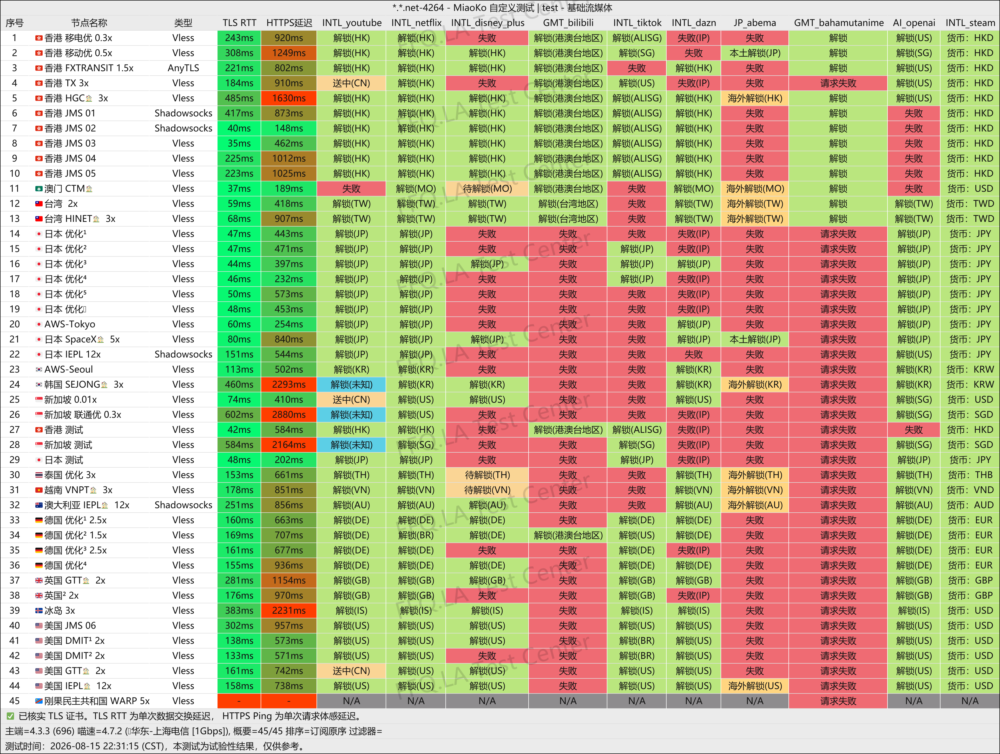

#### 2.2 AI Service Unblocking Report

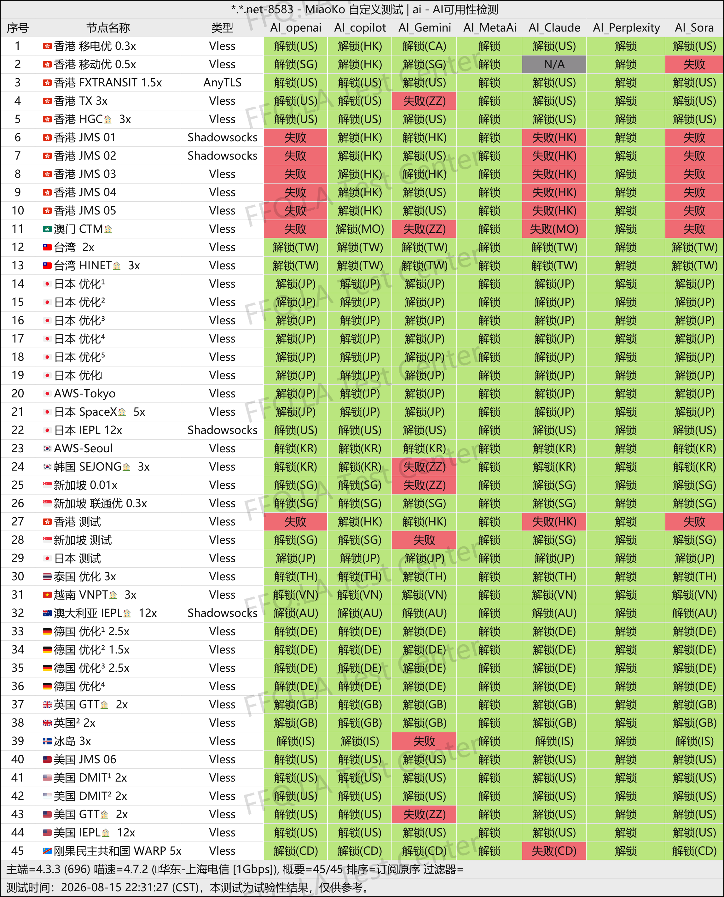

#### 3. Entry and Exit Node Analysis

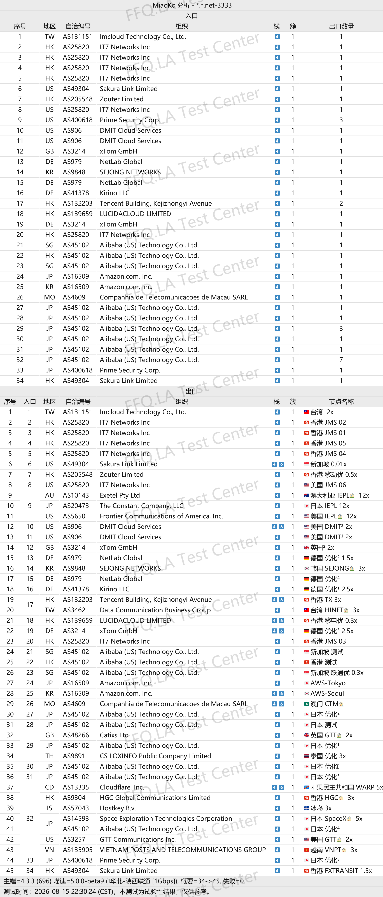

#### 4. Residential IP Quality and Cleanliness Analysis

##### 1. US

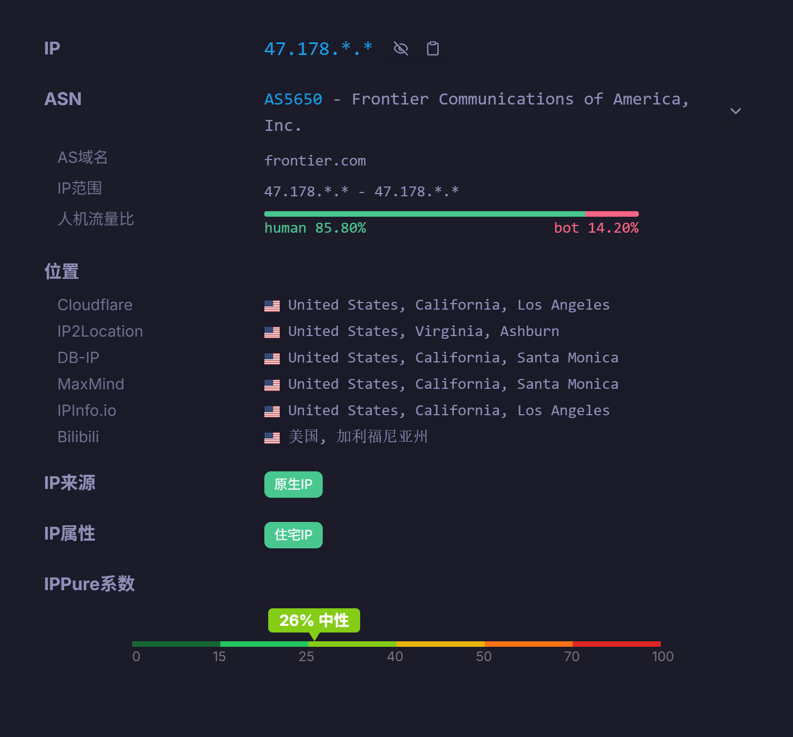

##### 2. Macau

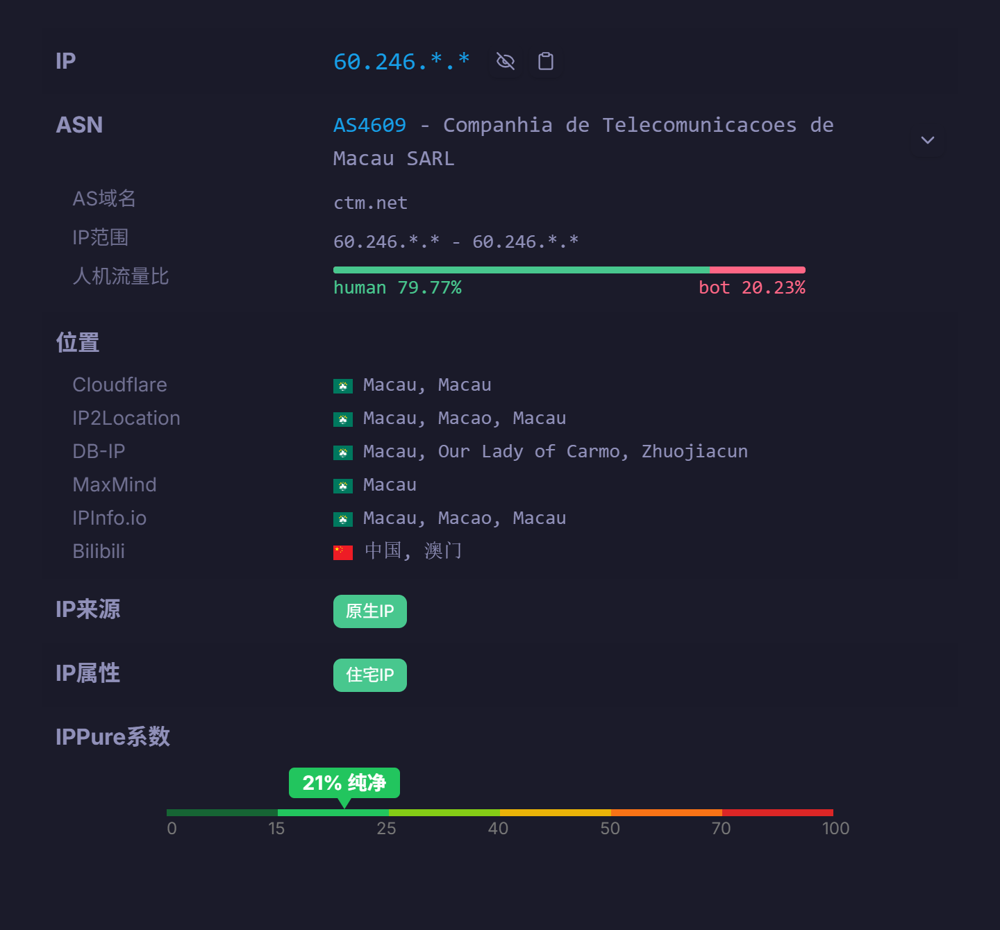

##### 3. Hong Kong

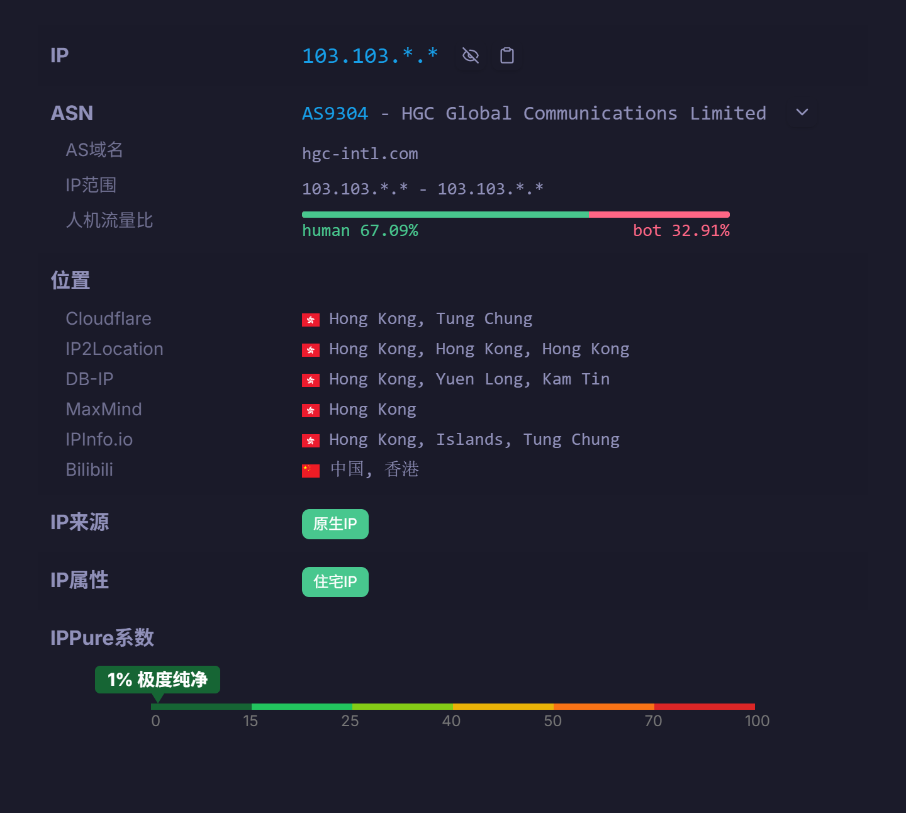

##### 4. Taiwan

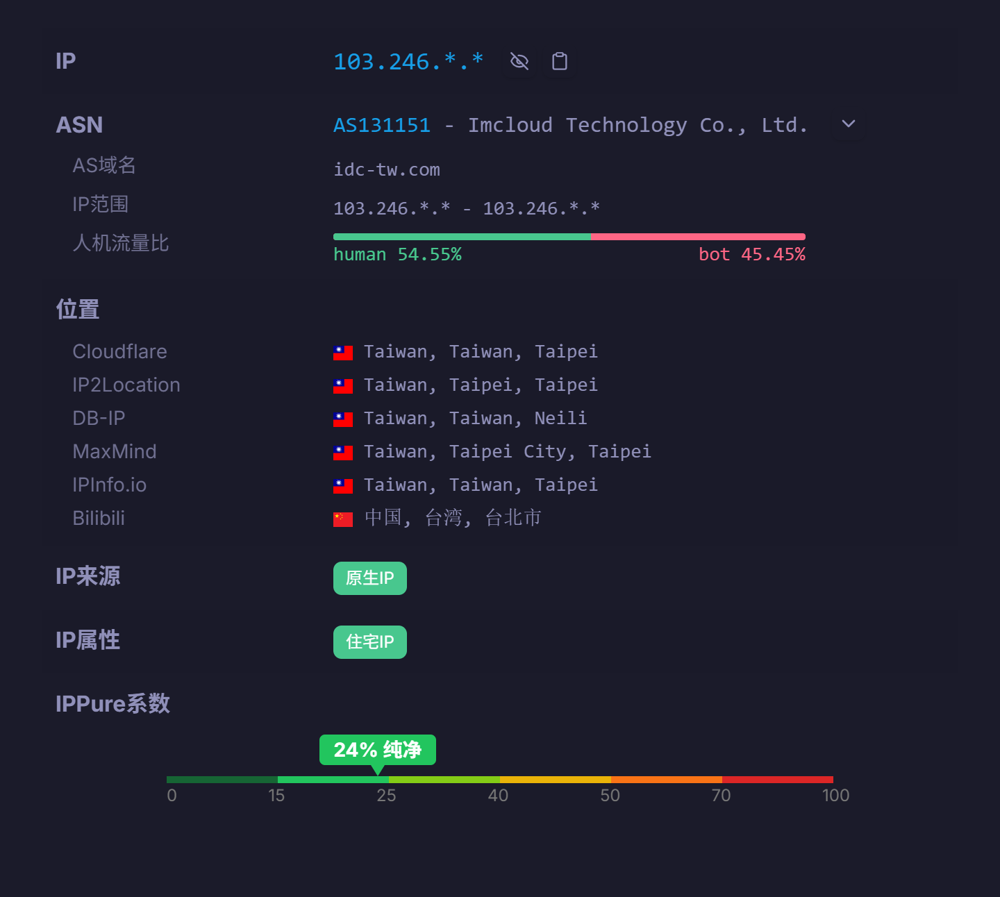

##### 5. Australia

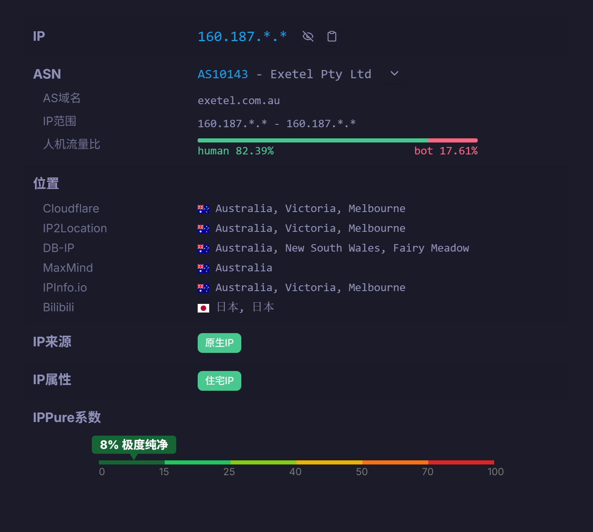

##### 6. Philippines

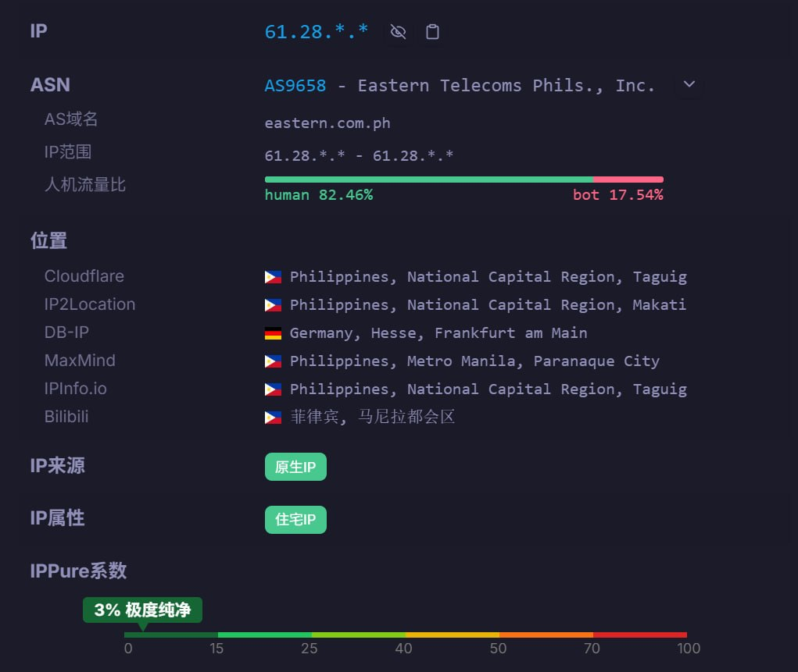
