 🇨🇳 [中文](README.md) | 🇺🇸 [English](README_EN.md) | 🇷🇺 [Русский](README_RU.md) | 🇮🇷 فارسی

# آدرس رسمی NIVA Network VPN (به‌روزرسانی 17 نوامبر 2026)

وب‌سایت رسمی NIVA Network VPN<br>
✅ دارای IP خانگی فیلیپین (برای اشتراک ارزان‌تر سرویس‌های هوش مصنوعی)<br>

جدیدترین آدرس 01: [app.niva.lol](https://to.iix.im/niva03)<br>
جدیدترین آدرس 02: [app.niva.lol](https://to.iix.im/niva01)<br>
آدرس رسمی: [mizuku.net](https://to.iix.im/niva02)<br>

معرفی بهترین سرویس‌های VPN و اشتراک‌گذاری نودهای پیشنهادی در سال 2026: [https://github.com/jdnei/JiChangTuiJian](https://github.com/jdnei/JiChangTuiJian)<br>

## انجمن تلگرامی VPN #AD

[گروه قرعه‌کشی VPN](https://331024.de/archives/choujiang) | [گروه گفت‌وگوی VPN](https://331024.de/archives/choujiang) | [گروه تست VPN](https://331024.de/archives/choujiang)<br>

[https://331024.de/archives/choujiang](https://331024.de/archives/choujiang)

## کد دعوت

`با ثبت‌نام از طریق این کد دعوت، یک اشتراک آزمایشی رایگان 2 روزه با 7 گیگابایت ترافیک دریافت می‌کنید (ارائه‌دهنده ممکن است این پیشنهاد را در هر زمانی لغو کند).`

```bash
Bfmlanad
```

---

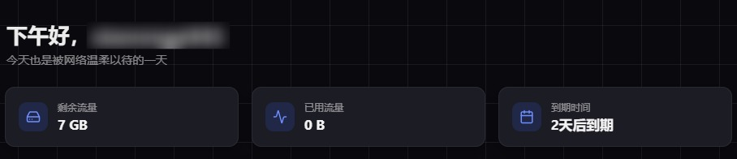

---

## کد تخفیف

`20% تخفیف؛ پایان اعتبار: 13 نوامبر`

```bash
NIVA2000
```

## معرفی

NIVA Network یک سرویس VPN با پشتیبانی از پروتکل‌های مختلف است که از VLESS + REALITY / XHTTP و Shadowsocks استفاده می‌کند.

این سرویس بر حفاظت از حریم خصوصی، سیاست عدم نگهداری گزارش فعالیت کاربران، پاسخ‌گویی سریع خدمات پشتیبانی و ارائه پشتیبانی فنی رایگان تأکید دارد.

## مزایا

- **سرورهای پایدار در مناطق مختلف جهان:** ارائه نودهایی در کشورهای مختلف، از جمله 🇭🇰 هنگ‌کنگ، 🇹🇼 تایوان، 🇯🇵 ژاپن، 🇸🇬 سنگاپور، 🇺🇸 ایالات متحده، 🇬🇧 بریتانیا و 🇵🇭 فیلیپین.<br>

- **نودهای دارای IP خانگی:** این سرویس برخی از سرورهای اینترنت خانگی و IPهای مسکونی را ارائه می‌دهد، از جمله [IP خانگی آمریکا](https://github.com/jdnei/niva#1us)، [IP خانگی ماکائو](https://github.com/jdnei/niva#2mo)، [IP خانگی هنگ‌کنگ](https://github.com/jdnei/niva#3hk)، [IP خانگی تایوان](https://github.com/jdnei/niva#4tw)، [IP خانگی استرالیا](https://github.com/jdnei/niva#5au) و [IP خانگی فیلیپین](https://github.com/jdnei/niva#6ph).<br>

- **بهینه‌سازی برای سه اپراتور اصلی چین:** مسیرهای شبکه برای افزایش پایداری اتصال بهینه‌سازی شده‌اند.<br>

- **نودهای دارای خطوط اختصاصی:** برخی بسته‌ها، از جمله بسته یک‌باره Lan (澜)، نودهای اضافی با `خطوط اختصاصی` ارائه می‌دهند که برای استفاده کاری بلندمدت و نیاز به اتصال پایدار مناسب هستند.<br>

## طرح‌های اشتراک

| سری | نام طرح | حجم ترافیک | قیمت | دوره پرداخت | سرعت | دستگاه‌های هم‌زمان | خطوط ارتباطی / نودها | ویژگی‌ها / توضیحات |
|---|---|---|---|---|---|---|---|---|
| MIO | MIO-Entry-R1 | 50 گیگابایت | ¥35 در ماه | ماهانه | بدون محدودیت سرعت | چند دستگاه (تعداد مشخص نشده) | بهینه‌سازی China Telecom CN2 / China Unicom 9929 / China Mobile CMI2؛ نودهای ISP و IP خانگی در سراسر جهان | گروه نود مستقل بدون نودهای Niva؛ بیشتر IPها متعلق به اینترنت خانگی واقعی و محلی هستند؛ بدون ضمانت SLA |
| MIO | MIO-Standard-R1 | 100 گیگابایت | ¥49 در ماه | ماهانه | بدون محدودیت سرعت | چند دستگاه (تعداد مشخص نشده) | بهینه‌سازی China Telecom CN2 / China Unicom 9929 / China Mobile CMI2؛ نودهای ISP و IP خانگی در سراسر جهان | گروه نود مستقل بدون نودهای Niva؛ بیشتر IPها متعلق به اینترنت خانگی واقعی و محلی هستند؛ بدون ضمانت SLA |
| MIO | MIO-Reserve-R1 | 300 گیگابایت | ¥105 در ماه | ماهانه | بدون محدودیت سرعت | چند دستگاه (تعداد مشخص نشده) | بهینه‌سازی China Telecom CN2 / China Unicom 9929 / China Mobile CMI2؛ نودهای ISP و IP خانگی در سراسر جهان | گروه نود مستقل بدون نودهای Niva؛ بیشتر IPها متعلق به اینترنت خانگی واقعی و محلی هستند؛ بدون ضمانت SLA |
| Niva | 💧 موج کوچک · استفاده شخصی سبک (涟) | 100 گیگابایت | ¥8.80 در ماه | ماهانه | 150Mbps | 5 دستگاه | مسیرهای بهینه‌شده China Unicom / China Mobile؛ خروجی‌های مسکونی و ISP در سراسر جهان | پوشش مناطق مختلف؛ مناسب استفاده روزمره از هوش مصنوعی و انتخاب خروجی‌های متعدد |
| Niva | 🌊 موج خروشان · استفاده روزمره (涌) | 300 گیگابایت | ¥15.80 در ماه | ماهانه | 300Mbps | 7 دستگاه | مسیرهای بهینه‌شده China Unicom / China Mobile؛ خروجی‌های مسکونی و ISP در سراسر جهان | مناسب استفاده روزمره، چندین دستگاه و سرویس‌های پخش آنلاین |
| Niva | 🌀 موج بزرگ · استفاده سنگین و گروهی (澜) | 550 گیگابایت | ¥25.80 در ماه | ماهانه | 1Gbps | 8 دستگاه | مسیرهای بهینه‌شده China Unicom / China Mobile؛ خروجی‌های مسکونی و ISP در سراسر جهان | مناسب کاربران پرمصرف، استفاده اشتراکی و نیاز به ترافیک بالا |
| ONE | 🫧 Cang · بسته ترافیک پایه (沧) | 150 گیگابایت (مجموع) | ¥29.80 | یک‌بار پرداخت / اعتبار دائمی | بدون محدودیت سرعت | چند دستگاه (تعداد مشخص نشده) | نودهای Niva؛ مسیرهای بهینه‌شده China Unicom / China Mobile؛ کسر ترافیک بر اساس ضریب هر نود | بدون تمدید خودکار؛ معتبر تا پایان ترافیک؛ امکان خرید مجدد و تجمیع مانده ترافیک |
| ONE | 🕳 Yuan · بسته پرترافیک (渊) | 500 گیگابایت (مجموع) | ¥68.80 | یک‌بار پرداخت / اعتبار دائمی | بدون محدودیت سرعت | چند دستگاه (تعداد مشخص نشده) | نودهای Niva؛ مسیرهای بهینه‌شده China Unicom / China Mobile؛ کسر ترافیک بر اساس ضریب هر نود | بدون تمدید خودکار؛ معتبر تا پایان ترافیک؛ امکان خرید مجدد و تجمیع مانده ترافیک |
| ONE | 🌌 Zhan · خانواده و چندین دستگاه (湛) | 4.88 ترابایت (مجموع) | ¥499 | یک‌بار پرداخت / اعتبار دائمی | بدون محدودیت سرعت | نامحدود | نودهای Niva؛ مسیرهای بهینه‌شده China Unicom / China Mobile؛ کسر ترافیک بر اساس ضریب هر نود | مناسب خانواده‌ها و کاربران چنددستگاهی؛ بدون تمدید خودکار؛ امکان تجمیع ترافیک باقی‌مانده |

### توضیحات طرح‌ها

- **سری MIO:** تمرکز اصلی بر بهینه‌سازی پیشرفته CN2 برای China Telecom است و در عین حال مسیرهای China Unicom و China Mobile نیز بهینه‌سازی می‌شوند. این سری از خطوط مستقیم باکیفیت CN2، 9929 و CMI2 استفاده می‌کند و خروجی‌های ISP را در کشورهای مختلف ارائه می‌دهد. بیشتر IPها متعلق به اینترنت خانگی واقعی هستند. این سری دارای گروه نود مستقل است و نودهای Niva را شامل نمی‌شود. همچنین ضمانت SLA ندارد.

- **سری Niva:** این سری بر بهینه‌سازی اتصال برای China Unicom و China Mobile تمرکز دارد و خروجی‌های مسکونی و ISP در سراسر جهان ارائه می‌دهد. برای استفاده روزمره از سرویس‌های هوش مصنوعی، انتخاب نودهای مناطق مختلف و استفاده از خروجی‌های متعدد مناسب است. پرداخت به‌صورت ماهانه انجام می‌شود.

- **سری ONE:** بسته‌های ترافیک یک‌باره مبتنی بر نودهای Niva هستند. اعتبار آن‌ها دائمی است، تمدید خودکار ندارند و تا پایان ترافیک خریداری‌شده قابل استفاده‌اند. امکان خرید مجدد و تجمیع ترافیک باقی‌مانده وجود دارد. ترافیک بر اساس ضریب مصرف هر نود کسر می‌شود.

- **تغییر طرح اشتراک:** کاربران دارای اشتراک Niva می‌توانند مستقیماً به MIO منتقل شوند و ارزش باقی‌مانده اشتراک قبلی به‌صورت خودکار از مبلغ خرید جدید کسر می‌شود.

- **پیشنهاد بر اساس اپراتور:** ارائه‌دهنده توصیه می‌کند کاربران China Telecom ابتدا MIO را انتخاب کنند، در حالی که کاربران China Unicom و China Mobile می‌توانند از Niva یا ONE استفاده کنند.

- **نکات مهم:** پایداری خطوط ISP مسکونی MIO تضمین نشده است و پوشش SLA ارائه نمی‌شود. سرعت واقعی و دسترس‌پذیری نودها به شرایط شبکه بستگی دارد.

## 📊 آزمایش عملکرد و تحلیل

#### 1.1 آزمایش سرعت China Telecom در ساعات اوج مصرف شبانه

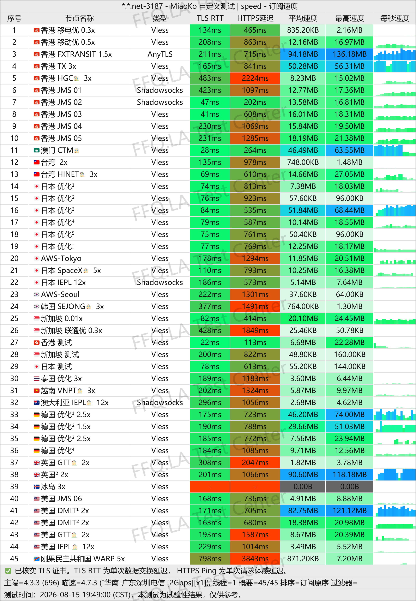

#### 1.2 آزمایش سرعت China Unicom در ساعات اوج مصرف شبانه

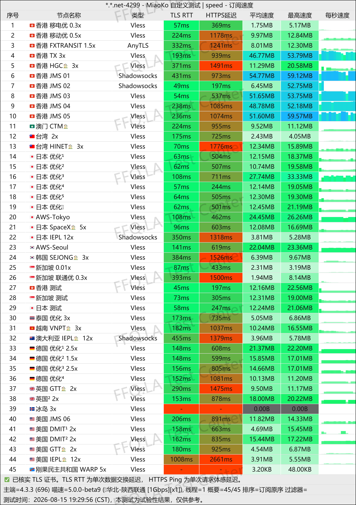

#### 1.3 آزمایش سرعت China Mobile در ساعات اوج مصرف شبانه

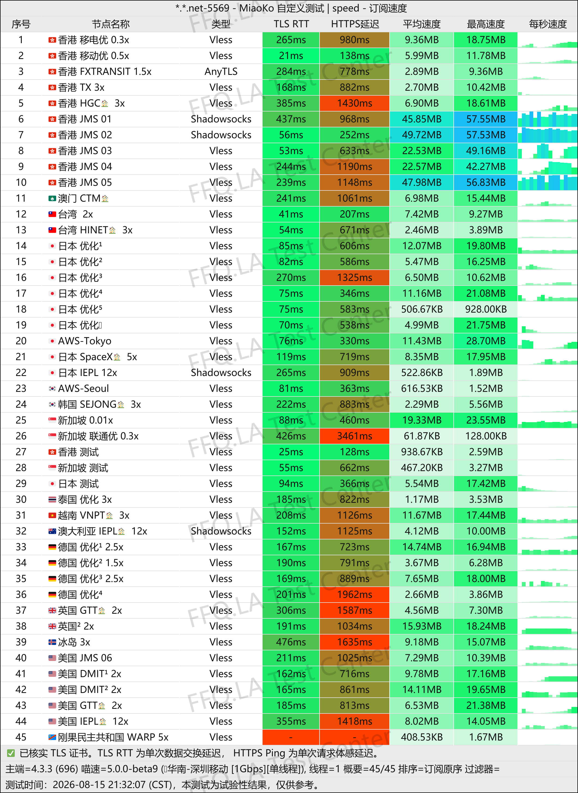

#### 2.1 گزارش رفع محدودیت سرویس‌های پخش آنلاین

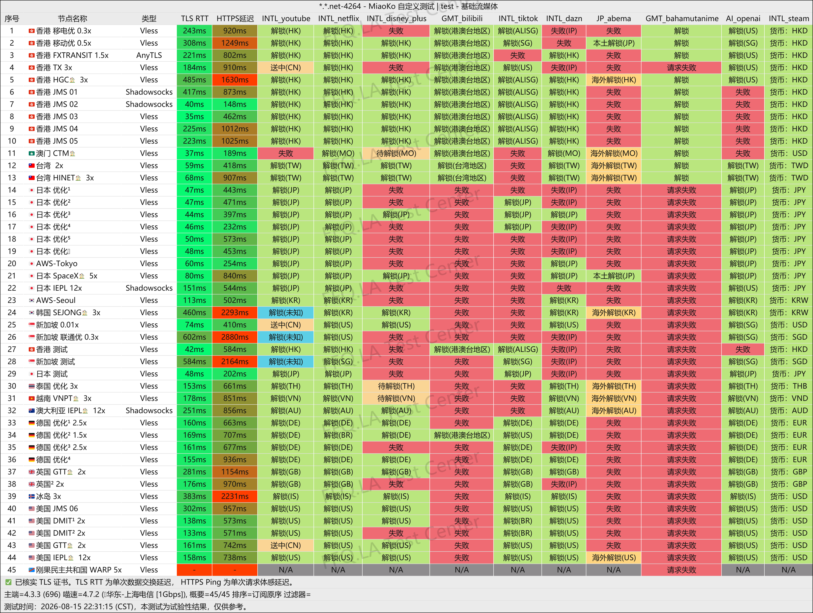

#### 2.2 گزارش دسترسی به سرویس‌های هوش مصنوعی

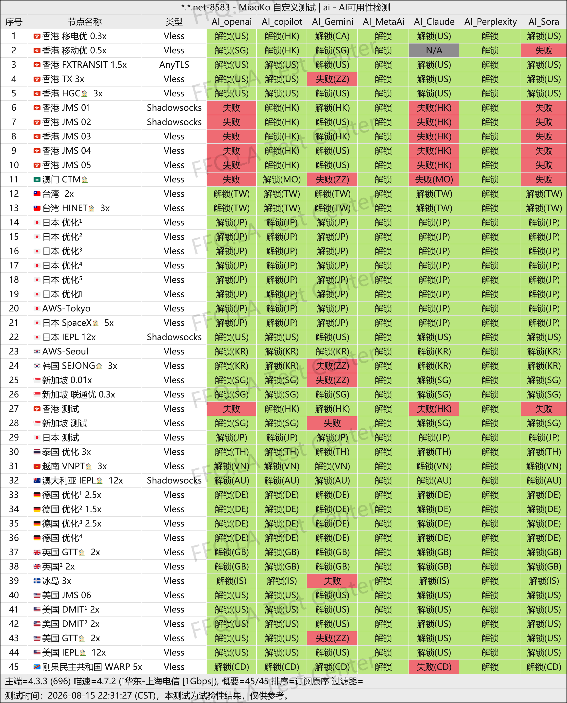

#### 3. تحلیل سرورهای ورودی و خروجی

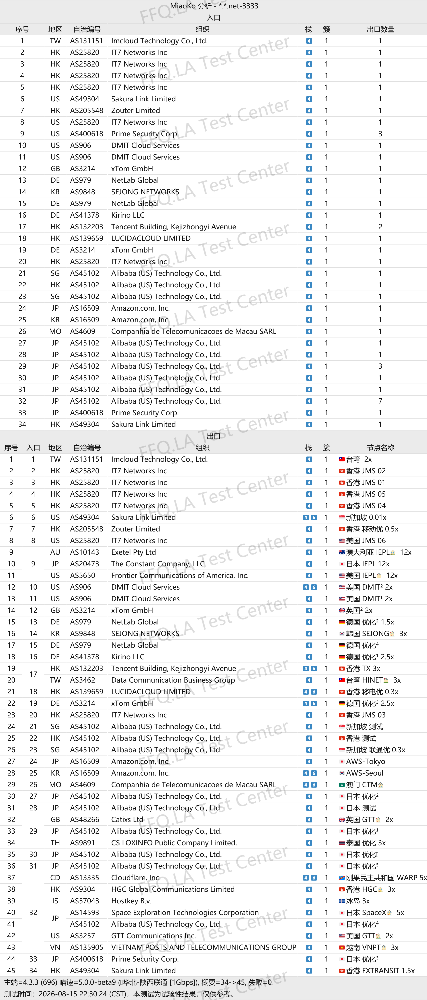

#### 4. تحلیل کیفیت و پاکی IPهای مسکونی

##### 1. آمریکا

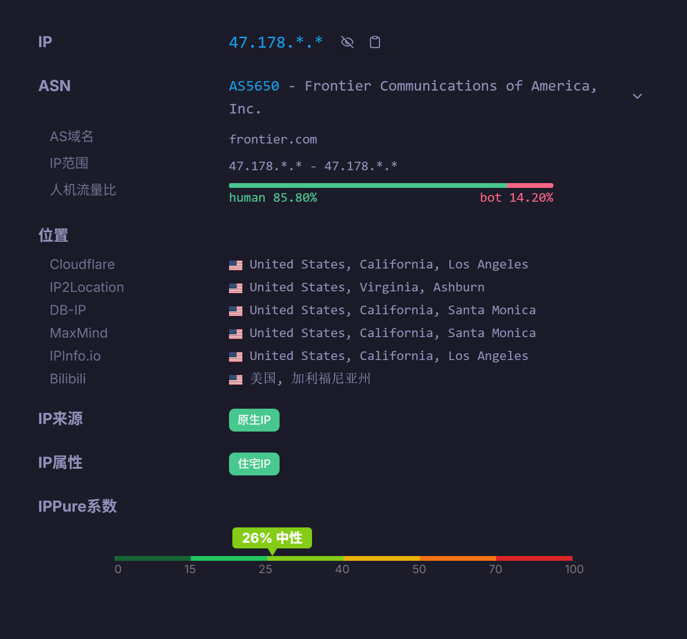

##### 2. ماکائو

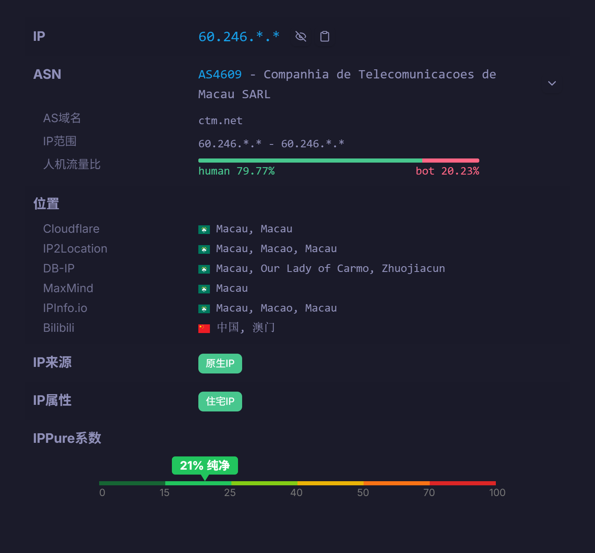

##### 3. هنگ‌کنگ

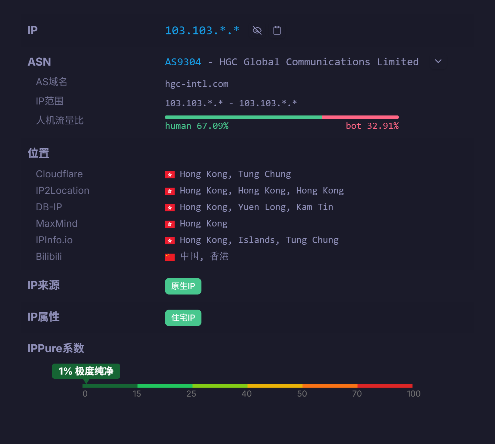

##### 4. تایوان

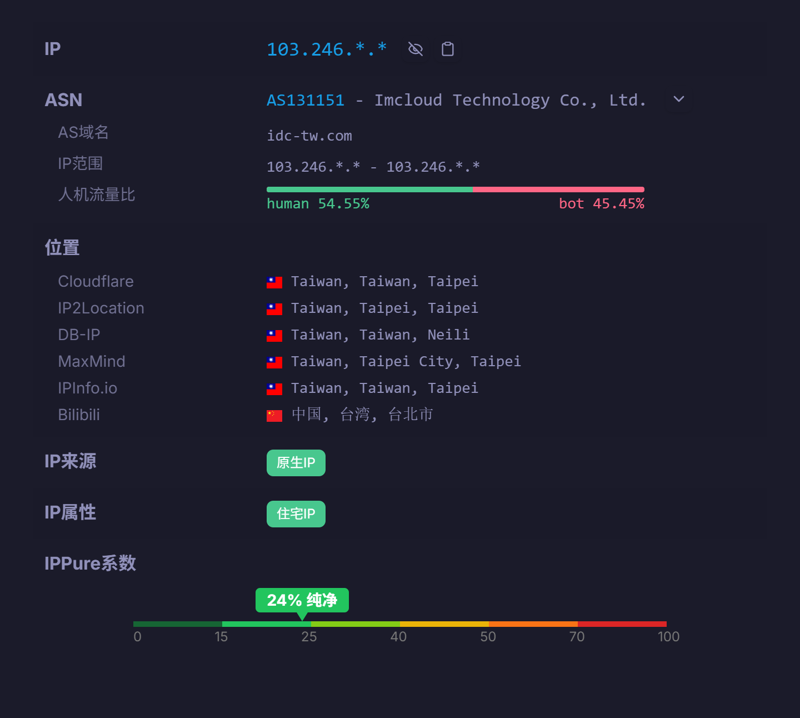

##### 5. استرالیا

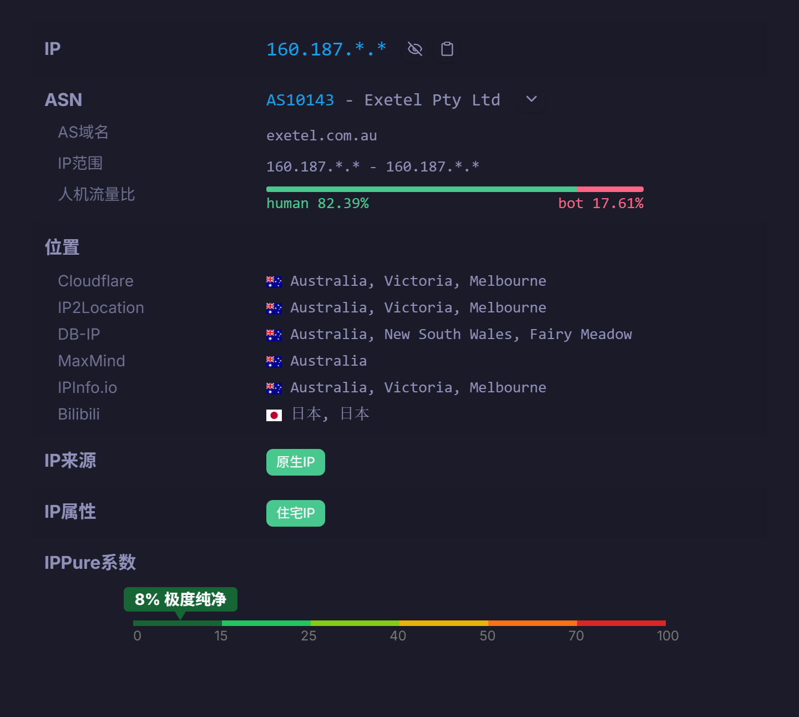

##### 6. فیلیپین

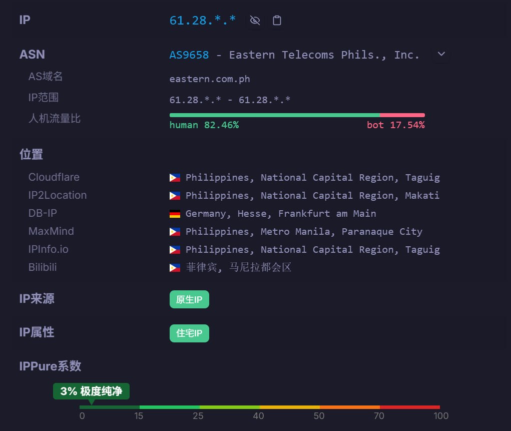
