🇨🇳 [中文](README.md) | 🇺🇸 [English](README_EN.md) | 🇷🇺 Русский | 🇮🇷 [فارسی](README_FA.md)

# Официальный сайт NIVA Network VPN (обновлено 21 ноября 2026)

Официальный сайт NIVA Network VPN<br>
✅ Доступны домашние IP-адреса Филиппин (для оформления более дешёвых подписок на ИИ-сервисы)<br>

Новый адрес 01: [app.niva.lol](https://to.iix.im/niva03)<br>
Новый адрес 02: [app.niva.lol](https://to.iix.im/niva01)<br>
Официальный адрес: [mizuku.net](https://to.iix.im/niva02)<br>

Лучшие VPN-сервисы и прокси-серверы 2026 года: [https://github.com/jdnei/JiChangTuiJian](https://github.com/jdnei/JiChangTuiJian)<br>

## Telegram-сообщество VPN #AD

[Группа розыгрышей VPN](https://331024.de/archives/choujiang) | [Чат VPN](https://331024.de/archives/choujiang) | [Группа тестирования VPN](https://331024.de/archives/choujiang)<br>

[https://331024.de/archives/choujiang](https://331024.de/archives/choujiang)

## Пригласительный код

`Зарегистрируйтесь с этим пригласительным кодом, чтобы получить бесплатную пробную подписку на 2 дня с 7 ГБ трафика (провайдер может отменить акцию в любое время).`

```bash
Bfmlanad
```

---

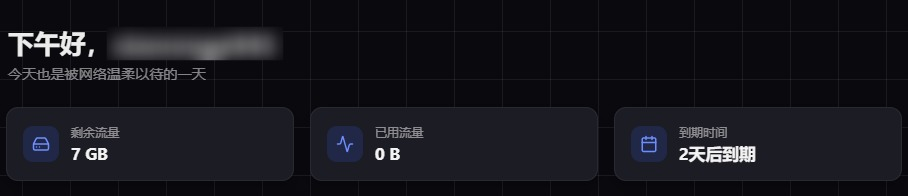

---

## Промокод / Код скидки

`Скидка 20%. Срок действия — до 13 ноября.`

```bash
NIVA2000
```

## Описание

NIVA Network VPN — сетевой сервис с поддержкой нескольких протоколов, включая VLESS + REALITY / XHTTP и Shadowsocks.

Провайдер уделяет особое внимание конфиденциальности, заявляет об отсутствии журналов активности, предлагает оперативную поддержку клиентов и бесплатную техническую помощь.

## Преимущества

- **Стабильные серверы в разных странах:** Доступны узлы в различных регионах, включая 🇭🇰 Гонконг, 🇹🇼 Тайвань, 🇯🇵 Японию, 🇸🇬 Сингапур, 🇺🇸 США, 🇬🇧 Великобританию и 🇵🇭 Филиппины.<br>

- **Домашние и резидентские IP-адреса:** Предлагаются отдельные узлы с домашними интернет-подключениями, включая [домашние IP США](https://github.com/jdnei/niva#1us), [домашние IP Макао](https://github.com/jdnei/niva#2mo), [домашние IP Гонконга](https://github.com/jdnei/niva#3hk), [домашние IP Тайваня](https://github.com/jdnei/niva#4tw), [домашние IP Австралии](https://github.com/jdnei/niva#5au) и [домашние IP Филиппин](https://github.com/jdnei/niva#6ph).<br>

- **Оптимизация для трёх основных операторов Китая:** Сетевые маршруты оптимизированы для повышения стабильности соединения.<br>

- **Выделенные сетевые узлы:** Некоторые тарифы, включая разовый пакет Lan (澜), предоставляют дополнительные `узлы с выделенными каналами связи`, предназначенные для стабильной и продолжительной работы.<br>

## Тарифные планы

| Серия | Тариф | Трафик | Цена | Период оплаты | Скорость | Одновременные устройства | Маршруты / Узлы | Особенности / Примечания |
|---|---|---|---|---|---|---|---|---|
| MIO | MIO-Entry-R1 | 50 ГБ | ¥35/месяц | Ежемесячно | Без ограничения скорости | Несколько устройств (точное количество не указано) | Оптимизация China Telecom CN2 / China Unicom 9929 / China Mobile CMI2; международные ISP-узлы и домашние IP | Независимая группа узлов без серверов Niva; большинство адресов являются настоящими локальными домашними IP; гарантия SLA не предоставляется |
| MIO | MIO-Standard-R1 | 100 ГБ | ¥49/месяц | Ежемесячно | Без ограничения скорости | Несколько устройств (точное количество не указано) | Оптимизация China Telecom CN2 / China Unicom 9929 / China Mobile CMI2; международные ISP-узлы и домашние IP | Независимая группа узлов без серверов Niva; большинство адресов являются настоящими локальными домашними IP; гарантия SLA не предоставляется |
| MIO | MIO-Reserve-R1 | 300 ГБ | ¥105/месяц | Ежемесячно | Без ограничения скорости | Несколько устройств (точное количество не указано) | Оптимизация China Telecom CN2 / China Unicom 9929 / China Mobile CMI2; международные ISP-узлы и домашние IP | Независимая группа узлов без серверов Niva; большинство адресов являются настоящими локальными домашними IP; гарантия SLA не предоставляется |
| Niva | 💧 Ripple · Лёгкое личное использование (涟) | 100 ГБ | ¥8.80/месяц | Ежемесячно | 150 Мбит/с | 5 | Оптимизация China Unicom / China Mobile; международные резидентские и ISP-узлы выхода | Покрытие нескольких регионов; поддержка повседневной работы с ИИ и выбор разных выходных узлов |
| Niva | 🌊 Surge · Основной повседневный тариф (涌) | 300 ГБ | ¥15.80/месяц | Ежемесячно | 300 Мбит/с | 7 | Оптимизация China Unicom / China Mobile; международные резидентские и ISP-узлы выхода | Подходит для ежедневного использования, нескольких устройств и потокового видео |
| Niva | 🌀 Lan · Интенсивное и совместное использование (澜) | 550 ГБ | ¥25.80/месяц | Ежемесячно | 1 Гбит/с | 8 | Оптимизация China Unicom / China Mobile; международные резидентские и ISP-узлы выхода | Для активных пользователей, совместного использования и большого расхода трафика |
| ONE | 🫧 Cang · Начальный пакет трафика (沧) | 150 ГБ (всего) | ¥29.80 | Единовременно / Бессрочно | Без ограничения скорости | Несколько устройств (точное количество не указано) | Узлы Niva; оптимизация China Unicom / China Mobile; списание трафика с учётом коэффициента | Без автоматического продления; действует до исчерпания трафика; повторная покупка и объединение остатков |
| ONE | 🕳 Yuan · Большой пакет трафика (渊) | 500 ГБ (всего) | ¥68.80 | Единовременно / Бессрочно | Без ограничения скорости | Несколько устройств (точное количество не указано) | Узлы Niva; оптимизация China Unicom / China Mobile; списание трафика с учётом коэффициента | Без автоматического продления; действует до исчерпания трафика; повторная покупка и объединение остатков |
| ONE | 🌌 Zhan · Семейный и многопользовательский (湛) | 4.88 ТБ (всего) | ¥499 | Единовременно / Бессрочно | Без ограничения скорости | Неограниченное количество устройств | Узлы Niva; оптимизация China Unicom / China Mobile; списание трафика с учётом коэффициента | Для семей и пользователей нескольких устройств; без автоматического продления; возможность объединения остатков трафика |

### Примечания к тарифным планам

- **Серия MIO:** Основное внимание уделяется высококачественной оптимизации CN2 для China Telecom, также предусмотрена оптимизация для China Unicom и China Mobile. Используются качественные прямые маршруты CN2, 9929 и CMI2. Предоставляются ISP-узлы выхода в разных странах и регионах, большинство IP-адресов относятся к настоящим домашним интернет-подключениям. Серия использует отдельную группу узлов, не включающую серверы Niva. Гарантия SLA отсутствует.

- **Серия Niva:** Ориентирована на оптимизацию соединений China Unicom и China Mobile. Предоставляет резидентские и ISP-узлы выхода в разных странах. Подходит для повседневной работы с ИИ, выбора серверов в различных регионах и использования нескольких выходных IP. Оплата производится ежемесячно.

- **Серия ONE:** Разовые пакеты трафика на базе узлов Niva. Они действуют бессрочно, не продлеваются автоматически и могут использоваться до полного исчерпания приобретённого объёма. Допускается повторная покупка с объединением оставшихся объёмов трафика. Списание происходит в соответствии с коэффициентом выбранного узла.

- **Переход между тарифами:** Пользователи с действующей подпиской Niva могут напрямую перейти на MIO. Оставшаяся стоимость текущей подписки автоматически вычитается из стоимости нового плана.

- **Рекомендации по операторам:** Провайдер рекомендует пользователям China Telecom выбирать MIO, а клиентам China Unicom и China Mobile — Niva или ONE.

- **Важные замечания:** Стабильность резидентских ISP-линий MIO не гарантируется, SLA не предоставляется. Фактическая скорость и доступность серверов зависят от сетевых условий.

## 📊 Тестирование производительности и анализ

#### 1.1 Тест скорости China Telecom в вечерние часы пик

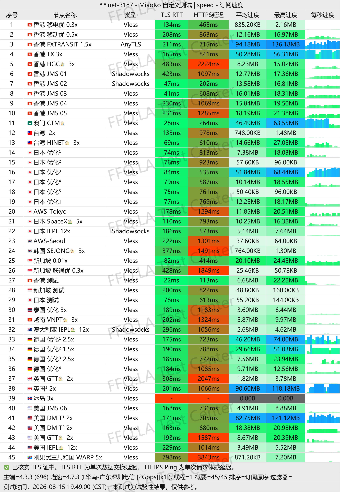

#### 1.2 Тест скорости China Unicom в вечерние часы пик

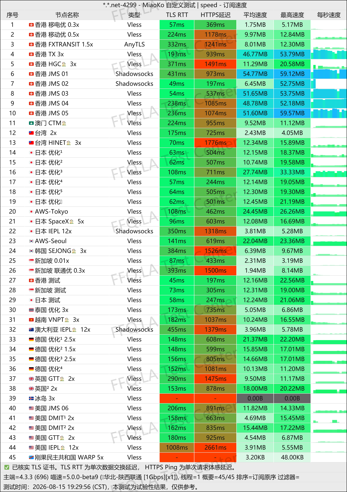

#### 1.3 Тест скорости China Mobile в вечерние часы пик

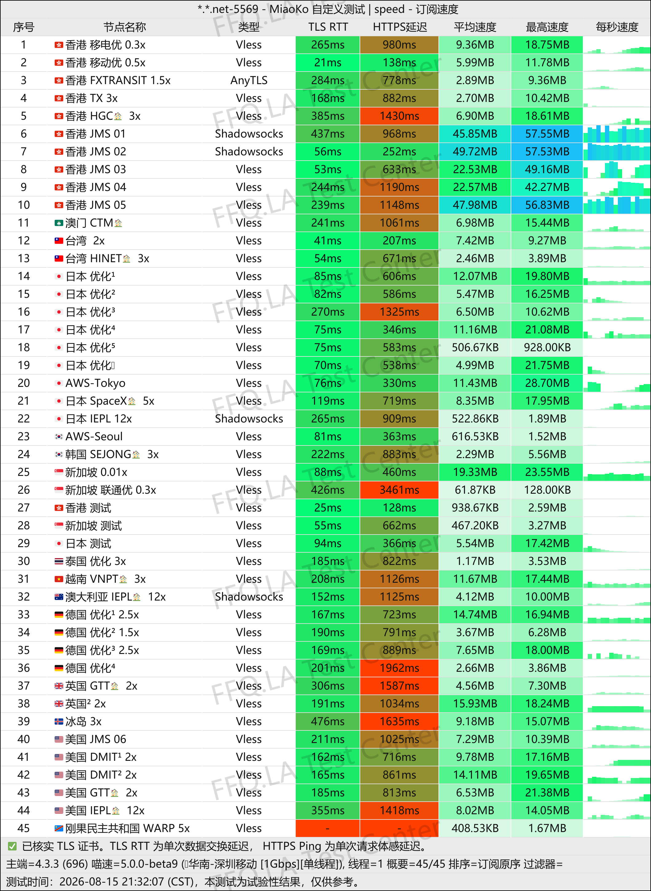

#### 2.1 Отчёт о разблокировке стриминговых сервисов

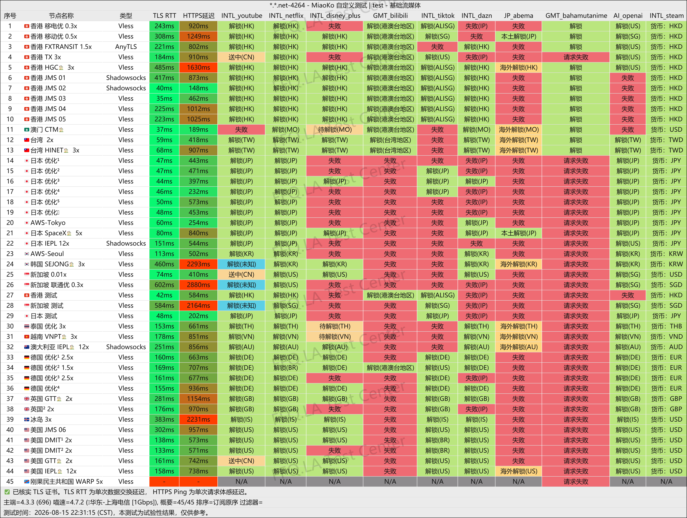

#### 2.2 Отчёт о доступности сервисов искусственного интеллекта

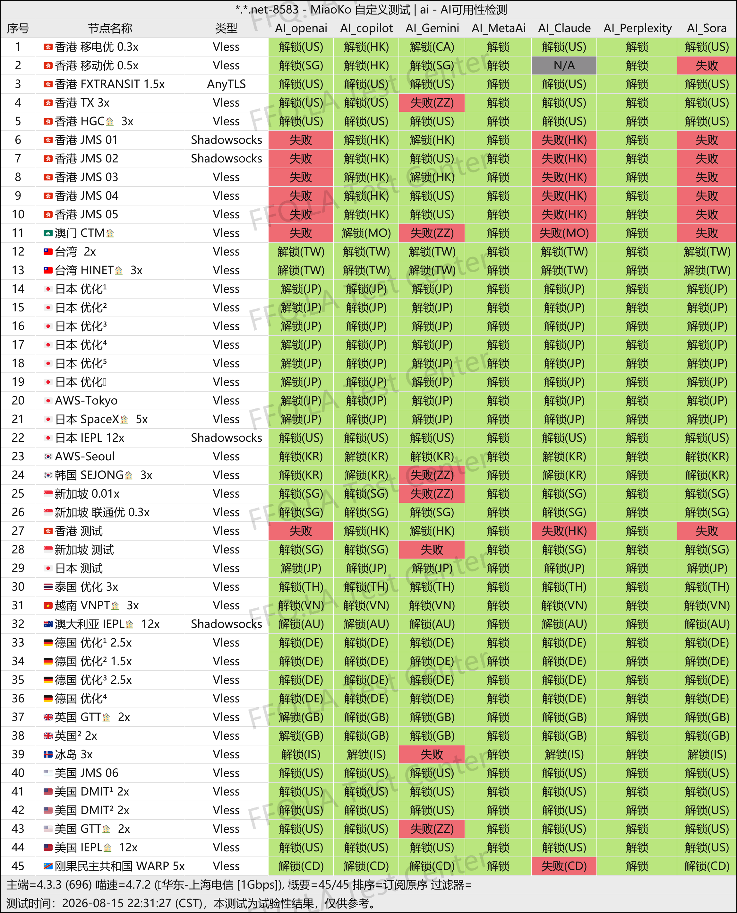

#### 3. Анализ входных и выходных узлов

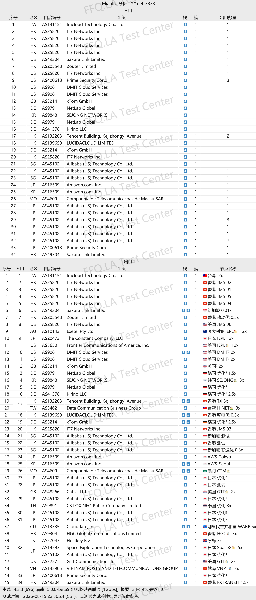

#### 4. Анализ качества и чистоты резидентских IP-адресов

##### 1. США

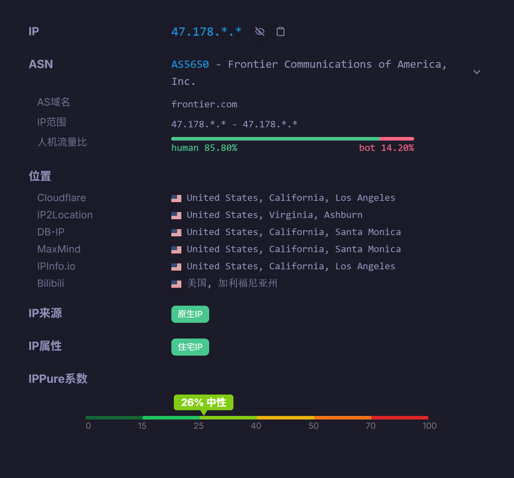

##### 2. Макао

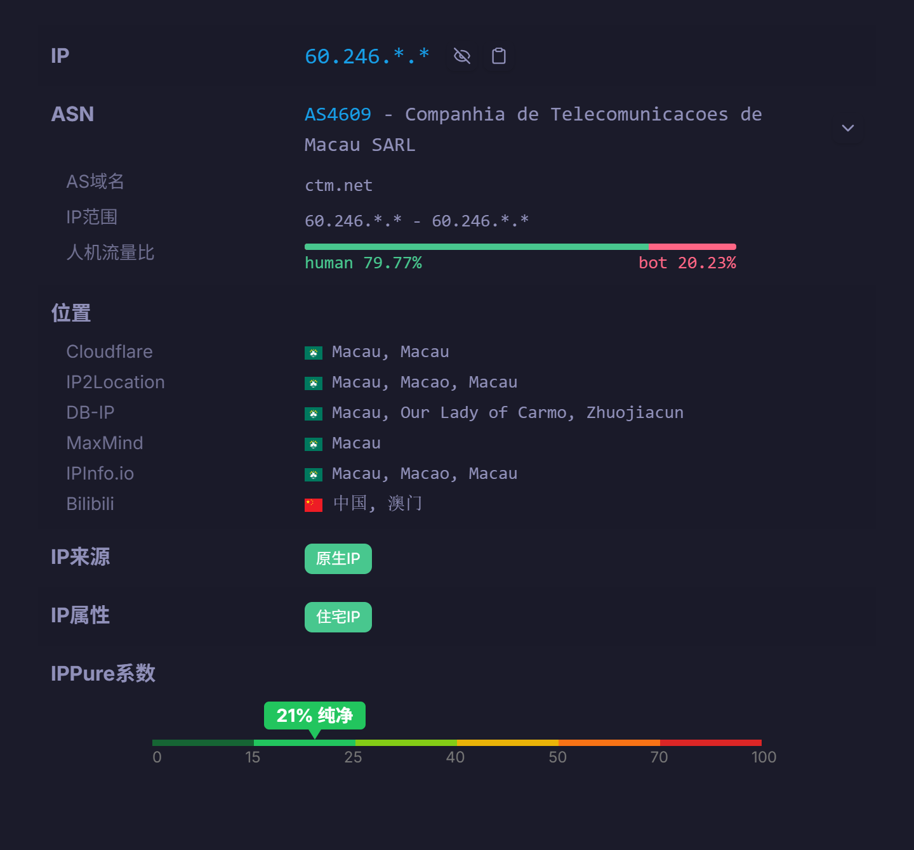

##### 3. Гонконг

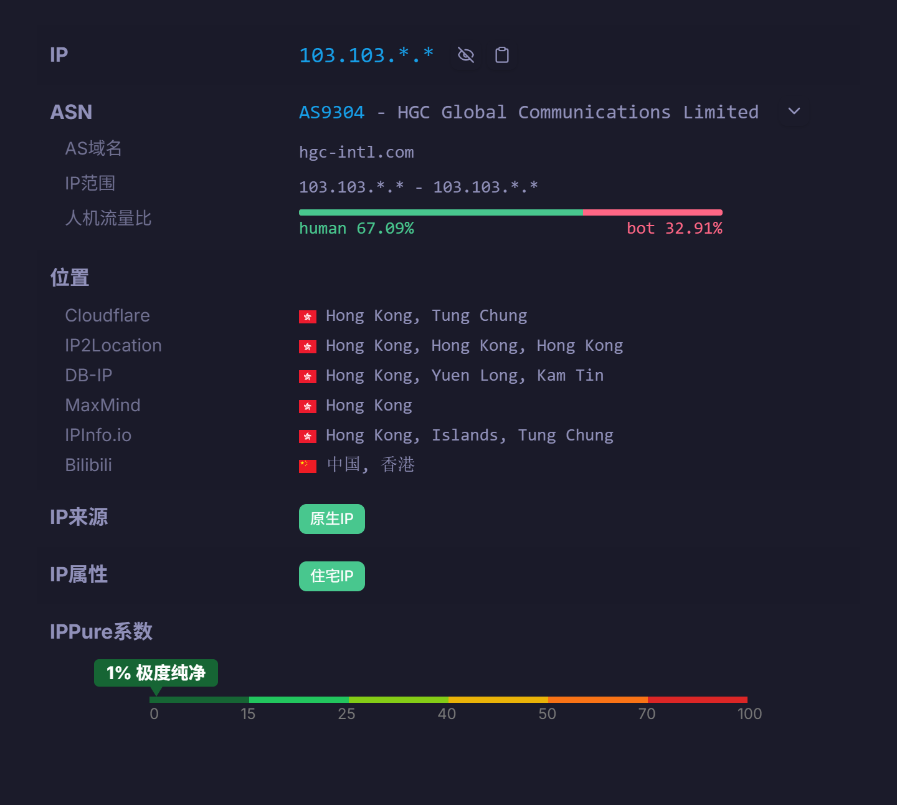

##### 4. Тайвань

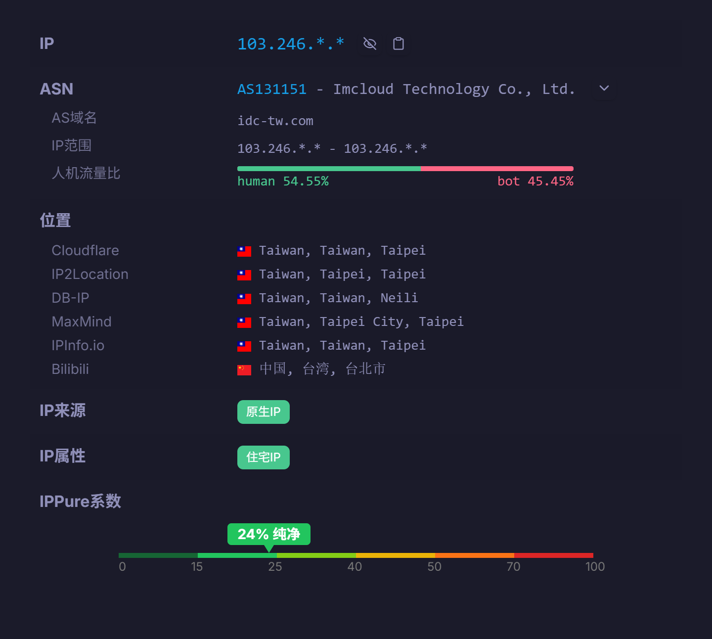

##### 5. Австралия

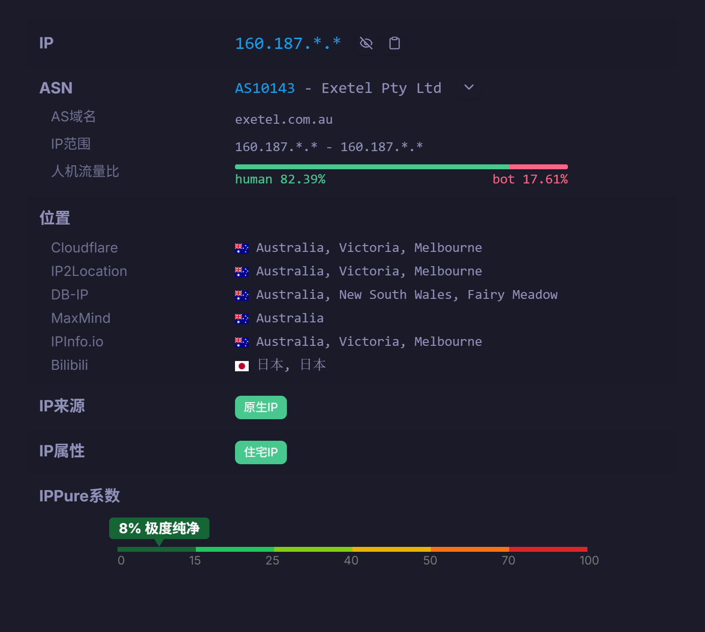

##### 6. Филиппины

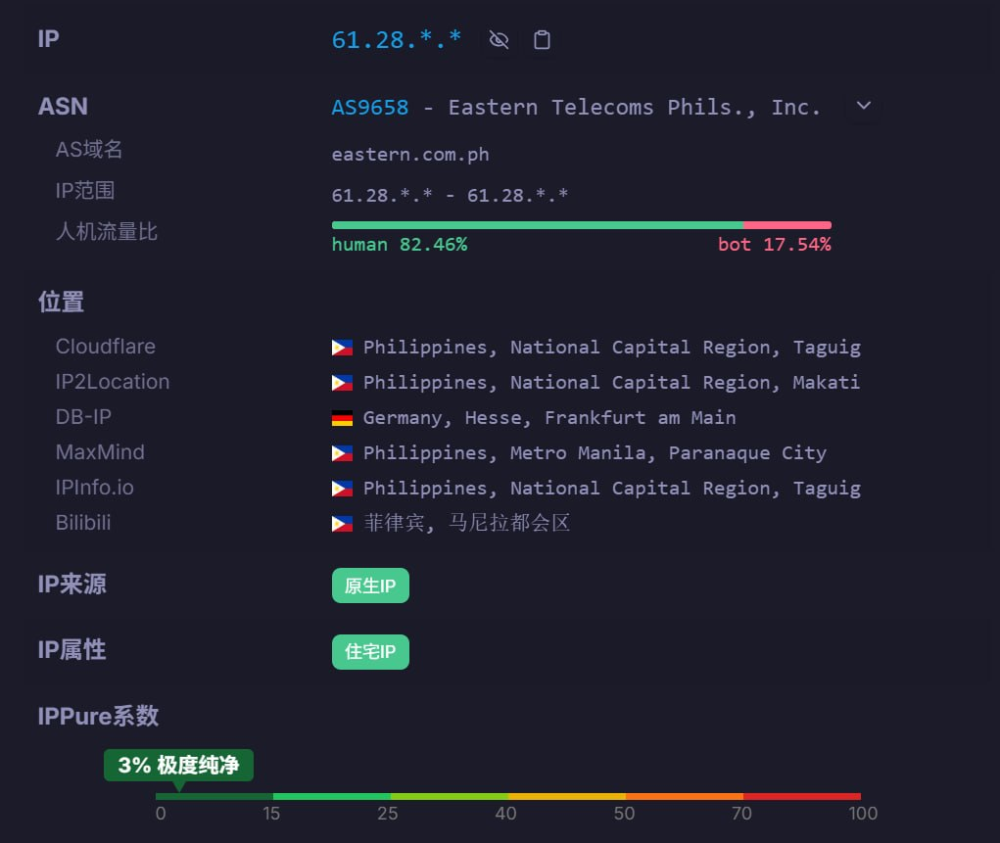
